# 구매 쿨링오프 + 후회 일기 (cool-off)

충동구매가 잦거나 결정이 어려울 때, 사고 싶은 것을 바로 사지 않고 며칠 기다렸다가 다시 묻는 작은 명령줄 도구입니다. 산 뒤에는 만족도를 기록하고, 구독료 총합과 후회 목록을 보여 줍니다. 스팀 게임만 다루는 [steam-buddy](../steam-buddy)를 모든 구매로 넓힌 버전입니다.

<!-- demo:start -->

<!-- demo:end -->

- **담기** `want`: 사고 싶은 것을 쿨링오프 목록에 넣습니다 (기본 3일).
- **확인** `check`: 쿨링오프가 끝난 것을 "아직 갖고 싶어?"라고 묻습니다. 구독 갱신 3일 전 알림도 여기서 나옵니다.
- **구매** `bought`: 산 것을 기록하고, 30일 뒤 만족도를 물어볼 날짜를 잡습니다.
- **구독** `sub`: 월/연 구독료를 관리하고 총합을 보여 줍니다.
- **돌아보기** `report`: 참은 금액, 평균 만족도, 후회 목록, 1만원당 만족도 순위, 월별 지출.

## 설치

Python 3.9 이상, 외부 패키지 없음.

```
cd cool-off
python -m cool_off want "에어팟 프로" --price 359000
```

선택: `pip install .` 후에는 `cool-off want ...`처럼 쓸 수 있습니다.

데이터는 `~/.cool-off/data.json`에 저장됩니다. 위치를 바꾸려면 환경변수 `COOLOFF_HOME`을 지정하세요.

## 사용 예

```
python -m cool_off want "에어팟 프로" --price 359000 --why "출퇴근 노캔" [--url ...] [--days 3]
python -m cool_off list
python -m cool_off check                   # 터미널에서 실행하면 y/n/later 로 바로 답함
python -m cool_off check --ntfy TOPIC      # 확인할 것을 폰(ntfy)으로도 보냄
python -m cool_off bought "에어팟 프로" --price 329000 [--date 2026-11-02|오늘|어제]
python -m cool_off sub add 넷플릭스 13500 --cycle monthly --day 15
python -m cool_off sub add 도메인 120000 --cycle yearly --month 3 --day 31
python -m cool_off sub list
python -m cool_off sub remove 넷플릭스     # 번호 또는 이름
python -m cool_off report
```

### 쿨링오프 답변

- `y`: 구매 허가. 사고 나면 `bought`로 기록합니다.
- `n`: 참은 것. 가격이 "아낀 돈"에 더해집니다.
- `later`: 하루 뒤에 다시 묻습니다.
- 빈칸: 그대로 두고 다음 `check`에서 다시 묻습니다.

### 사후 확인

구매 후 30일이 지나면 `check`가 "아직 써? 만족도 1-5"와 사용 빈도(매일 / 주1-2 / 거의 안 씀)를 묻습니다. 만족도 2 이하이거나 거의 안 쓴 것은 후회 목록에 올라갑니다.

### 구독료 총합

연간 구독은 1년에 한 번 결제하는 금액으로, 월간 구독은 12배로 환산해 합산합니다. 월 합계는 연 합계를 12로 나눈 값(반올림)입니다. 치킨은 1마리 2만원으로 환산합니다.

```
[구독료 총합 방송] 매달 47,800원, 1년이면 573,600원 — 치킨 28마리
```

결제일이 없는 달은 말일로 당겨집니다. 예를 들어 31일 결제는 2월에 28일(윤년이면 29일)입니다.

## 알림 (ntfy)

1. 폰에 ntfy 앱(https://ntfy.sh)을 설치하고 주제를 구독합니다.
2. **ntfy 주제는 공개라서 이름만 알면 누구나 읽을 수 있습니다.** 추측하기 어려운 이름을 쓰세요 (예: `cool-off-k3x9q2m7vz41hd`).
3. `check --ntfy 주제` 로 실행합니다. 같은 항목은 한 번만 보내고, 전송에 실패하면 메시지를 출력하고 다음 `check`에서 다시 보냅니다.

## 리포트 계산 방식

- **참은 금액**: `n`으로 참은 것의 가격 합계.
- **평균 만족도**: 만족도를 기록한 구매의 평균.
- **원당 만족도 (1만원당)**: `만족도 × 10,000 ÷ 가격`. 높을수록 가성비가 좋습니다.
- **월별 구매 지출**: 구매 기록의 월별 합계.

## 테스트

```
python -m unittest discover -s tests -v
```

쿨링오프 종료 시각, 30일 뒤 확인, 구독 갱신(월말 날짜 포함), 리포트 계산, 저장, ntfy 실패 처리를 가짜 시각과 가짜 네트워크로 검사합니다.
