# demo-maker

CLI 프로젝트의 **터미널 데모 애니메이션(SVG)** 과 **README 사용법 섹션**을 자동으로 만들어 주는 도구입니다.
Python 3.12+ 표준 라이브러리만 사용합니다 (설치할 것 없음, 네트워크 불필요).

- 데모 스크립트(JSON)에 적힌 명령을 **진짜로 실행**하고, 출력과 타이밍을 기록합니다.
- 실행은 임시 HOME 샌드박스에서만 일어나므로 내 데이터(`~/.steam-buddy` 등)를 건드리지 않습니다.
- 결과는 CSS 키프레임만 쓰는 **자체 완결형 SVG** (JS 없음, 외부 리소스 없음) 라서 GitHub README 에서 그대로 재생됩니다.

## 빠른 시작

```bash
cd demo-maker
python3 -m demomaker run examples/steam-buddy.demo.json          # -> examples/steam-buddy.demo.svg
python3 -m demomaker run examples/kakao-wrapped.demo.json -o out.svg
python3 -m demomaker run demo.json --static -o last-frame.svg    # 마지막 화면만 (애니메이션 없음)
python3 -m demomaker run demo.json --trace trace.json            # 실행 기록 저장
python3 -m demomaker render trace.json -o again.svg              # 명령 재실행 없이 다시 그리기
```



## 데모 스크립트 형식 (JSON)

```json
{
  "title": "steam-buddy: 환불 기한",
  "project": "../../steam-buddy",
  "cwd": "{{work}}",
  "env": {"STEAM_BUDDY_HOME": "{{home}}/.steam-buddy"},
  "width": 80,
  "height": 24,
  "steps": [
    {"type": "setup", "files": {"home/.steam-buddy/data.json": {"games": {}}}},
    {"type": "comment", "text": "# 환불 기한 확인"},
    {"type": "cmd", "run": "python -m steam_buddy status", "show": "steam-buddy status", "typing_speed": 0.05},
    {"type": "pause", "seconds": 1}
  ]
}
```

최상위 키

| 키 | 기본값 | 설명 |
| --- | --- | --- |
| `title` | `demo` | 창 제목 표시줄과 접근성 라벨 |
| `project` | - | 프로젝트 폴더(스크립트 파일 기준 상대 경로). `{{project}}` 로 쓸 수 있고 `cwd` 기본값이 됨 |
| `cwd` | `project` 또는 스크립트 폴더 | 명령을 실행할 폴더. `{{work}}` 를 쓰면 빈 임시 작업 폴더에서 실행 |
| `env` | `{}` | 추가 환경변수 (기존 환경에 합침) |
| `width` | 80 | 터미널 칸 수 (전각 문자는 2칸). `COLUMNS` 로도 전달됨 |
| `height` | 24 | 화면에 보이는 최대 줄 수. 넘치면 스크롤 |
| `line_delay` | 0.05 | 출력 줄이 나타나는 간격(초) |
| `timeout` | 30 | 명령 하나의 제한 시간(초) |

step 종류

| type | 필드 | 설명 |
| --- | --- | --- |
| `cmd` | `run`, `show`, `typing_speed`(0.05), `timeout`, `allow_fail`, `hidden`, `max_lines` | 명령을 타이핑하고 실제로 실행. `show` 는 화면에 보일 문구(없으면 `run`). `hidden` 은 실행만 하고 화면에는 안 나옴. 종료코드가 0 이 아니면 `allow_fail` 이 없는 한 오류 |
| `comment` | `text`, `typing_speed`(0.03) | `$ # 설명` 같은 주석 줄을 타이핑 |
| `pause` | `seconds` | 잠시 멈춤 |
| `setup` | `files` | 샌드박스 안에 파일 만들기 (`{"home/x.json": {...}}`, 객체면 JSON 으로 저장). 화면에는 안 나옴 |

자리표시자: `{{sandbox}}` `{{home}}` `{{work}}` `{{script_dir}}` `{{project}}`, 그리고 상대 시각
`{{days_ago:N}}` `{{hours_ago:N}}` `{{minutes_ago:N}}` (ISO 시각 문자열. "구매 3일 전" 같은 시드 데이터용).
`run` 은 `shlex.split` 으로 쪼갠 뒤 인자마다 치환하므로 경로에 공백이 있어도 안전합니다.

### 실행 방식과 안전장치

- `subprocess.Popen(argv_list, shell=False)` — `;`, `$HOME`, 백틱 등은 셸이 해석하지 않고 글자 그대로 전달됩니다.
- `python` / `python3` 로 시작하는 명령은 지금 쓰는 인터프리터로 바뀝니다.
- `HOME`, `USERPROFILE`, `APPDATA`, `LOCALAPPDATA`, `XDG_*`, `TMPDIR/TEMP/TMP` 는 임시 샌드박스로 **강제 덮어쓰기**. 끝나면 폴더째 삭제됩니다.
- 이름에 `KEY/TOKEN/SECRET/PASSWORD/CREDENTIAL/AUTH/COOKIE` 가 들어간 환경변수는 자식 프로세스에 넘기지 않습니다.
- `PYTHONDONTWRITEBYTECODE=1` 이라 대상 프로젝트 폴더에 `__pycache__` 를 만들지 않습니다.
- stdout/stderr 는 도착한 순서대로 시간과 함께 기록. 타임아웃이면 프로세스를 죽이고 오류를 냅니다.

## 렌더링

- 어두운 터미널 창 (제목 표시줄 점 3개), 폰트 `"D2Coding", "Nanum Gothic Coding", "Malgun Gothic", monospace`.
- **모든 글자를 칸 격자에 맞춰 x 좌표를 직접 지정**합니다. 폰트가 바뀌어도 한글(전각 2칸, `unicodedata.east_asian_width`)과 표 정렬이 어긋나지 않습니다.
- ANSI SGR: 기본 16색, 밝은색, 굵게/흐리게/밑줄/반전, 256색과 트루컬러, `\r` 덮어쓰기. 그 외 이스케이프는 버립니다.
- 칸 수를 넘는 줄은 자동 줄바꿈 (전각 문자는 쪼개지 않음), 화면보다 길면 한 줄씩 스크롤.
- 명령은 글자 단위로 타이핑(clipPath 폭 애니메이션 + 커서), 출력은 줄 단위로 나타납니다. 느린 명령은 실제 대기 시간(최대 2초)을 반영합니다.
- `prefers-reduced-motion` 에서는 애니메이션 없이 마지막 화면을 보여 줍니다. `--static` 은 처음부터 마지막 화면만 담습니다.
- 애니메이션은 마지막 화면에서 3초 머문 뒤 처음부터 반복됩니다.

GIF: 표준 라이브러리만으로는 만들 수 없어서 선택 기능입니다. `playwright` + `Pillow` 가 설치되어 있으면
`python3 -m demomaker run demo.json --gif demo.gif` 가 프레임을 캡처해 만들고, 없으면 안내만 하고 SVG 만 저장합니다.

## README 사용법 섹션 만들기

```bash
python3 -m demomaker readme ../steam-buddy                   # Markdown 만 출력 (파일은 안 건드림)
python3 -m demomaker readme ../steam-buddy --svg docs/demo.svg --write
```

`pyproject.toml` 의 `[project.scripts]` (없으면 `__main__.py` 가 있는 패키지) 를 찾아 `python -m <패키지> --help` 와
각 하위 명령의 `--help` 를 샌드박스에서 실행하고, 데모 SVG 를 넣은 "사용법" 섹션을 만듭니다.
`--write` 를 주면 README 의 `<!-- demo:start -->` ~ `<!-- demo:end -->` 사이만 바꾸고, 마커가 없으면 끝에 덧붙입니다.
여러 번 실행해도 결과가 같습니다 (멱등). 옵션: `--readme PATH`, `--heading "## 사용법"`, `--no-sub-help`.

## 같이 들어 있는 예제 (모두 오프라인)

| 스크립트 | 내용 |
| --- | --- |
| `examples/steam-buddy.demo.json` | 임시 `STEAM_BUDDY_HOME` 에 구매 기록을 시드한 뒤 `status`, `rate`, `report` |
| `examples/kakao-wrapped.demo.json` | `examples/make_sample_chat.py` 로 가짜 단톡방 대화를 만들고 `--anonymize` 로 결산 |
| `examples/sub-vocab.demo.json` | 테스트 픽스처 `sample.srt` 로 `--no-llm` 단어장 생성 |

각 `.demo.svg` 는 300KB 미만입니다. 상대 시각(`days_ago`)과 현재 날짜가 출력에 들어가므로 날짜가 바뀌면 다시 생성하세요.

## 테스트

```bash
python3 -m unittest discover -s tests -v
```

ANSI 파싱, 전각 폭/줄바꿈, SVG 정합성(`xml.etree` 파싱, 외부 참조 없음), 키프레임 단조 증가, 샌드박스(HOME/APPDATA, `shell=False`),
README 마커 삽입 멱등성을 검사합니다.

## 구조

```
demomaker/
  script.py   데모 JSON 읽기/검증
  runner.py   샌드박스 실행, 출력+타이밍 기록, 자리표시자
  ansi.py     SGR 파싱, 전각 폭, 줄바꿈 화면 모델
  render.py   Recording -> 애니메이션 SVG
  readme.py   pyproject/argparse 조사, Markdown 섹션, 마커 삽입
  gif.py      (선택) Playwright+Pillow GIF
  cli.py      run / render / readme
```
