# gamecal - 내 게임 캘린더

Steam 보유 게임의 공지를 모아 **점검/이벤트 캘린더(.ics 구독 피드)**, **서비스 종료 D-day 경보**,
**패치노트 한국어 요약 다이제스트**를 만들어 주는 파이썬(표준 라이브러리만, 3.9+) 도구입니다.

<!-- demo:start -->

<!-- demo:end -->

## 기능

- 게임 목록: 설정 파일의 appid 목록 + (선택) steam-buddy의 `~/.steam-buddy/data.json` 가져오기 (읽기 전용)
- Steam `GetNewsForApp` 공지 수집 (요청 간 지연, 디스크 캐시, 실패 시 오래된 캐시 사용)
- BBCode/Steam 마크업(`[h1]`, `[list]`, `[*]`, `[img]`, `{STEAM_CLAN_IMAGE}` 등) 제거
- 분류: 패치노트 / 점검 / 이벤트 / 서비스 종료 / 기타 (영어+한국어 키워드)
- 날짜/시각 추출 후 KST 변환 (`November 5, 2026`, `Nov 5 at 10:00 UTC`, `2026-11-05 02:00 PST`, `11/05`, `2026년 11월 5일 오후 2시` 등).
  날짜를 못 찾으면 게시일 종일 "공지"로 등록
- 패치노트 한국어 요약: 로컬 OpenAI 호환 서버(기본 `http://127.0.0.1:8080/v1`, 프록시 미사용) 호출, 불가능하면 앞부분 발췌(번역 없음)
- 출력: `out/gamecal.ics`, `out/YYYY-MM-DD.md`(새 소식 다이제스트), D-30/D-7/D-1 경보(콘솔 + 선택적 ntfy)
- 본 공지 gid를 `state.json`에 저장해 중복 처리 방지 (일정은 상태에 보관되어 ics에 계속 유지)

## 설치 / 설정

```bash
cd game-calendar
cp gamecal.example.json gamecal.json     # 편집
python3 -m gamecal add 570               # appid 추가
python3 -m gamecal list                  # 추적 게임/예정된 서비스 종료
python3 -m gamecal run --dry-run         # 저장 없이 시험 (LLM 미사용)
python3 -m gamecal run                   # 실제 실행
```

`gamecal.json` 주요 항목 (상대 경로는 설정 파일 위치 기준):

| 키 | 설명 |
|---|---|
| `appids`, `names` | 추적할 appid, 표시 이름 `{"570": "Dota 2"}` |
| `steam_buddy.enabled/path` | steam-buddy 데이터 가져오기 |
| `llm.base_url/model/enabled` | 요약용 로컬 엔드포인트 |
| `ntfy.server/topic` | topic이 비어 있으면 콘솔 출력만 |
| `dday` | 경보 시점 (기본 `[30,7,1]`, 당일은 D-DAY) |
| `default_tz` | 시간대 표기가 없는 시각에 가정할 TZ (기본 UTC) |
| `ics_keep_days` | 이보다 오래된 일정은 ics에서 제외 (기본 60) |

경보는 임계 구간마다 한 번만 발송됩니다. 실행을 건너뛰어 D-7을 놓쳐도 D-5에 처음 실행하면 한 번 알려 줍니다.
ntfy 전송에 실패하면 다음 실행에서 재시도합니다.

## .ics 구독 방법

`out/gamecal.ics`를 HTTP로 제공하거나 동기화 폴더에 두세요.

- **Tailscale**: `cd out && python3 -m http.server 8099 --bind <tailscale-ip>` 후
  `http://<tailscale-ip>:8099/gamecal.ics` 를 구독 URL로 사용 (폰도 같은 tailnet이어야 함).
- **Google Calendar**: 설정 > 캘린더 추가 > URL로 추가. 단, Google 서버가 접근해야 하므로 공개 URL이어야 하며
  Tailscale 사설 주소는 불가합니다 (Tailscale Funnel 또는 공개 호스팅 필요). 갱신 주기도 Google이 정합니다(수 시간~하루).
- **iPhone**: 설정 > 캘린더 > 계정 > 계정 추가 > 기타 > 구독 캘린더 추가에 URL 입력 (Tailscale 사설 주소 가능).
- **Android/Google 앱 대신**: ICSx5 같은 구독 앱에 URL 입력 (Tailscale 가능).
- 동기화 폴더(Syncthing, Dropbox 등)로 파일만 받아 캘린더 앱에서 가져오기도 가능하나, 가져오기는 구독과 달리 자동 갱신되지 않습니다.

점검/서비스 종료 일정에는 1일 전 알림(VALARM)이 들어 있습니다. UID는 공지 gid 기반이라 갱신해도 중복되지 않습니다.

## JSON 출력(다른 도구 연동용)

`python3 -m gamecal alerts --json [--days N]` 은 네트워크를 쓰지 않고 `state.json`만 읽어 예정 일정을 stdout에 JSON으로 출력합니다.
(`--config`로 설정 파일 지정 가능, 상태 파일이 없으면 빈 목록을 출력하며 아무 파일도 만들지 않습니다.)

- 점검/이벤트/패치: 오늘(KST)부터 N일 이내 시작하는 항목 (기본 14일, `--days`로 변경)
- 진행 중 항목(`ongoing: true`): 시작일이 오늘보다 앞이지만 아직 끝나지 않았고 종료일이 N일 이내인 항목도 포함합니다.
  "아직 끝나지 않음"은 배타적 `end`가 오늘 00:00(KST)보다 뒤라는 뜻이므로, 어제 끝난 항목은 제외되고 오늘이 마지막 날인 항목은 포함됩니다.
- 서비스 종료: 오늘부터 60일 이내 (고정). 날짜가 확인되지 않은 공지는 제외하며 진행 중 규칙은 적용하지 않음
- 정렬: `start` 오름차순
- 시각은 `+09:00` ISO8601, 종일 일정은 해당 날짜 `00:00:00+09:00`이며 `end`는 배타적(다음 날 00:00)입니다.
- `d_day`: `generated_for` 기준 시작일까지의 일수 (0 = 당일, 진행 중 항목은 음수)
- `ends_in_days`: `end` 날짜에서 `generated_for`를 뺀 일수 (종일 일정은 배타적 종료 기준, `end`가 없으면 null)
- `ongoing`: 시작일이 `generated_for`보다 앞이면 true

```json
{"version": 1, "generated_for": "2026-11-04", "items": [
  {"kind": "shutdown", "game": "Dota 2", "appid": 570, "title": "Server Shutdown", "start": "2026-11-20T00:00:00+09:00",
   "end": "2026-11-21T00:00:00+09:00", "all_day": true, "d_day": 16, "ends_in_days": 17, "ongoing": false,
   "url": "https://store.steampowered.com/news/app/570/view/1"}
]}
```

스키마 버전은 `version`(현재 1)이며, 검증 함수는 `gamecal/contract.py`의 `validate(obj)`입니다 (위반 시 `ValueError`).
`kind`는 `maintenance`, `event`, `shutdown`, `patch` 중 하나입니다.

## 작업 스케줄러 예시 (Windows)

```
schtasks /Create /SC HOURLY /MO 6 /TN "gamecal" /TR "cmd /c cd /d C:\path\game-calendar && py -3 -m gamecal run >> gamecal.log 2>&1"
```

Linux는 cron: `0 */6 * * * cd /path/game-calendar && python3 -m gamecal run >> gamecal.log 2>&1`

## 테스트

```bash
python3 -m unittest discover -s tests -v
```

네트워크/LLM은 가짜(fake)로 대체되어 있어 오프라인에서 실행됩니다.

## 한계

- **날짜 추출은 휴리스틱**입니다. 본문의 여러 날짜 중 게시일 이전 날짜는 무시하고, 서비스 종료는 가장 이른 날짜,
  점검은 첫 날짜, 이벤트는 최소~최대 날짜 범위를 사용합니다. 오탐/누락이 있을 수 있으니 중요한 일정은 원문 링크로 확인하세요.
- 시간대 표기 없는 시각은 `default_tz`(기본 UTC)로 가정합니다. `CST`는 미국 중부(UTC-6)로 해석하며, PT/ET는 미국 서머타임 규칙을 날짜 단위로 근사합니다.
- `11/05`는 월/일로 해석하고, 연도가 없으면 게시일 기준 가까운 미래로 추정합니다.
- 서비스 종료는 시각이 있어도 해당 KST 날짜의 종일 일정으로 처리합니다. 일정이 확인되지 않은 종료 공지는 D-day 경보 대상이 아닙니다.
- 패치노트가 아닌 항목은 LLM 요약 없이 앞부분 발췌만 합니다. LLM 서버가 한 번 실패하면 그 실행에서는 재시도하지 않습니다.
- Steam 공지 피드(`steam_community_announcements`)만 조회하며, 게임사 외부 공지는 포함되지 않습니다.
