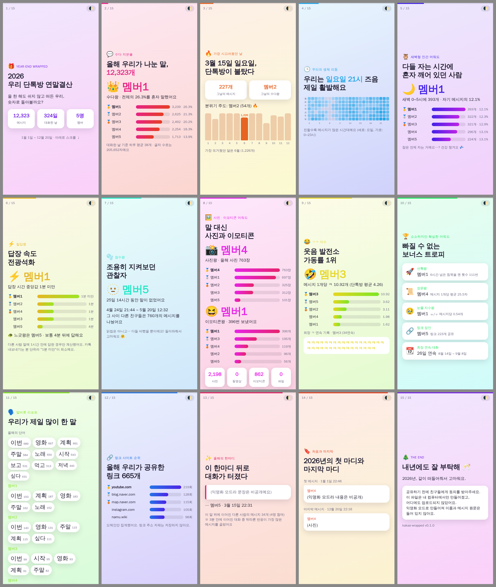

# kakao-wrapped 🎁

카카오톡 **단톡방 대화 내보내기 파일**로 Spotify Wrapped 같은 **연말결산 슬라이드(HTML 한 장)** 를 만들어 주는 도구입니다.
친구들과 "올해의 수다왕", "칼답왕", "새벽형 인간", "ㅋㅋ 지수"를 같이 보며 놀기 좋아요.

<!-- demo:start -->

<!-- demo:end -->

- Python 3.9+ · **표준 라이브러리만** 사용 (설치할 것 없음)
- **모든 처리는 내 컴퓨터에서만** 이뤄집니다. 네트워크 요청 없음, 결과 HTML도 외부 CDN/폰트/스크립트 없이 한 파일로 완결
- 휴대폰에서 보기 좋은 카드(슬라이드) 레이아웃, 라이트/다크 모드 지원



> 위 이미지는 **가짜 데이터**로 만든 샘플(`examples/sample.html`, 익명화 모드)입니다.

## 빠른 시작

```bash
python3 -m kakao_wrapped KakaoTalk_chat.txt --year 2026 --out wrapped.html
# 열기: wrapped.html 을 브라우저(또는 폰으로 전송)로 열면 끝
```

```
python -m kakao_wrapped <내보내기 파일> [--year 2026] [--out wrapped.html]
                        [--anonymize] [--top 5] [--json] [--json-out PATH]
```

| 옵션 | 설명 |
|---|---|
| `--year` | 결산할 연도. 생략하면 파일에 있는 **가장 최근 연도** |
| `--out` | 출력 HTML 경로 (기본 `wrapped.html`) |
| `--anonymize` | 이름을 `멤버1..N`으로 바꾸고(대화량 순, 일관되게), **메시지 원문 인용을 모두 제외**. 말버릇 목록에서도 멤버 이름을 걸러냄. 방 이름도 숨김 |
| `--top` | 순위/말버릇 목록에 보여줄 인원 수 (기본 5) |
| `--json` | 계산된 통계를 `<out>.json` 으로도 저장 (`--json-out PATH`로 경로 지정) |

샘플 만들어 보기 (가짜 대화 생성 → 익명화 결산):

```bash
python3 examples/make_sample_chat.py /tmp/sample_chat.txt
python3 -m kakao_wrapped /tmp/sample_chat.txt --year 2026 --anonymize --out examples/sample.html
```

## 대화 내보내기 방법

> 앱 버전에 따라 메뉴 이름·위치가 조금 다를 수 있어요.

**PC (Windows/Mac 카카오톡)**
1. 단톡방을 열고 우측 상단 **메뉴(≡)** 클릭
2. **대화 내보내기** → **텍스트 저장** (또는 "대화 내용 저장") → `.txt` 파일 저장

**Android**
1. 단톡방 → 우측 상단 **≡** → 우측 하단 **⚙ 설정**
2. **대화 내용 내보내기** → **텍스트 메시지만 보내기** (사진·동영상은 필요 없어요) → 내 파일/메일/드라이브 등에 저장
3. 일부 버전/경로에서는 CSV(`Date,User,Message`)로 저장되기도 해요. 이것도 지원합니다.

**iOS**
1. 단톡방 → 우측 상단 **≡** → **⚙ 설정**
2. **대화 내용 내보내기** → **텍스트 메시지만 보내기** → "파일에 저장" 등으로 저장

내보내기는 보통 방 전체 기록이 한 파일로 나옵니다. 기록이 아주 많으면 일부만 나올 수 있으니, 결산이 이상하면 기간을 확인해 보세요.

### 지원 형식 (자동 감지)

| 형식 | 예시 |
|---|---|
| PC txt | `--------------- 2026년 1월 3일 토요일 ---------------` + `[홍길동] [오후 3:05] 메시지` |
| Android txt | `2026년 1월 3일 토요일` + `2026년 1월 3일 오후 3:05, 홍길동 : 메시지` |
| iOS txt (점 표기, 신형 Android도 동일) | `2026. 1. 3. 오후 3:05, 홍길동 : 메시지` (24시간제 `15:05` 도 가능) |
| 모바일 CSV | `Date,User,Message` / `2026-01-03 15:05:00,"홍길동","메시지"` |
| 영어 로캘 | `Jan 3, 2026, 3:05 PM, Name : msg`, `January 3, 2026 at 3:05 PM, ...`, PC `[Name] [PM 3:05] msg` |

여러 줄 메시지는 앞 메시지에 이어 붙이고, `들어왔습니다/나갔습니다/초대했습니다` 같은 시스템 줄과 `삭제된 메시지입니다`는 따로 처리합니다. `사진`, `사진 N장`, `동영상`, `이모티콘`, `파일: …`, `음성메시지`는 단어가 아니라 **미디어**로 셉니다. 인코딩은 UTF-8/UTF-8 BOM/UTF-16/CP949를 자동으로 처리합니다.

## 어워드 설명

| 카드 | 의미 / 계산 방식 |
|---|---|
| 수다 지분율 | 선택한 연도의 사람별 메시지 수와 비율 (시스템 메시지 제외) |
| 가장 시끄러웠던 날 / 달 | 하루/한 달 메시지가 가장 많은 날·달, 그날의 수다왕 |
| 우리의 생체 리듬 | 요일 × 시간대(0~23시) 히트맵 |
| 새벽형 인간 | **0시~5시59분**에 보낸 메시지가 가장 많은 사람 (비율도 표시) |
| 칼답왕 | 다른 사람 메시지 **직후** 내 메시지까지 걸린 시간의 **중앙값**이 가장 짧은 사람. **1시간 넘는 간격은 답장으로 보지 않음**, 답장이 5번 미만이면 제외. 반대편에 '느긋왕'. 내보내기는 **분 단위**라 "1분 미만"이 최소 단위 |
| 잠수왕 (읽씹왕 아님 😉) | 같은 사람의 두 메시지 사이 **가장 긴 침묵** 중, 그동안 **다른 사람 메시지가 20개 이상**(=방이 활발했던) 경우만. 마지막 발언 이후 지금까지의 침묵도 포함. 가볍게 보세요! |
| 사진왕 / 이모티콘왕 | 사진(`사진 N장`은 N장) / 이모티콘 개수 |
| ㅋㅋ 지수 | 텍스트 메시지 1개당 `ㅋ` 평균 개수 (5개 미만 말한 사람 제외), 한 메시지 안 **최장 ㅋ 연속** |
| 소소한 어워드 | 선톡왕(6시간 넘게 조용하던 방에서 먼저 말 꺼낸 횟수), 장문왕(평균 글자 수), 눈물 지수왕(ㅠ/ㅜ), 링크 장인, 최장 연속 대화일 |
| 말버릇 리포트 | 공백/문장부호 기준으로 나누고 흔한 조사·어미를 **간단한 규칙으로** 떼어낸 뒤 불용어(`진짜`, `그냥` …), `ㅋㅋ/ㅎㅎ`, URL, 숫자를 제외한 많이 쓴 단어 |
| 링크 사이트 순위 | 공유된 링크의 **도메인만** 집계 (`youtu.be`→`youtube.com`, `www.`/`m.` 제거) |
| **올해의 한마디** | 반응 수(리액션)는 내보내기에 없어서 휴리스틱 사용: 메시지를 3분 이내 간격의 **대화 덩어리**로 나누고, 어떤 텍스트 메시지 **뒤에 같은 덩어리에서 다른 사람이 보낸 메시지가 가장 많은** 것을 선택 (동점이면 반응한 사람 수가 많은 쪽 → 더 이른 메시지). 실제 단어가 있는 100자 이하 메시지만 후보 (ㅋㅋ만/링크만 제외) |
| 처음과 마지막 | 해당 연도의 첫 메시지와 마지막 메시지 |

## 개인정보 · 동의 (꼭 읽어 주세요) 🔒

- 대화 내보내기 파일에는 **친구들의 개인적인 메시지**가 그대로 들어 있습니다. 파일을 클라우드·메신저에 함부로 올리지 마세요. (이 도구는 아무것도 업로드하지 않습니다.)
- **결과물을 단톡방 밖에 공유하기 전에 친구들의 동의를 꼭 받으세요.** 이름, 대화 시간대(생활 패턴), 메시지 문장이 드러날 수 있습니다.
- 가장 안전한 방법은 `--anonymize` 입니다. 이름이 `멤버1..N`으로 바뀌고 첫/마지막 메시지·올해의 한마디 같은 **메시지 원문 인용이 모두 빠집니다.** (다만 활동 패턴만으로 누군지 짐작할 수는 있으니 동의는 여전히 중요해요.)
- 익명화하지 않아도 인용문(첫/마지막 메시지, 올해의 한마디)에서 **전화번호·이메일·주민번호/카드번호 형태·URL은 자동으로 가려집니다** (`[전화번호]`, `[이메일]`, `[링크]`). 그래도 완벽하지 않으니 공유 전에 직접 확인하세요.
- 내보내기 파일과 `wrapped.html/json` 은 `.gitignore`에 넣어 두었습니다. 실수로 저장소에 커밋하지 마세요.

## 테스트

```bash
cd kakao-wrapped
python3 -m unittest discover -s tests -v
```

테스트 데이터는 모두 가짜(철수/영희/민수)입니다.

## 구조

```
kakao_wrapped/
  parser.py    형식 자동 감지 + 파싱 (PC/Android/iOS/영문/CSV), 미디어·시스템 분류
  textutil.py  개인정보 가리기, 링크 도메인, 간단한 한국어 토큰화
  stats.py     통계/어워드 계산, 익명화
  render.py    자체 완결형 HTML 생성 (인라인 CSS/JS, SVG 히트맵)
  cli.py       python -m kakao_wrapped
examples/      가짜 샘플 생성기, sample.html, sample.png, screenshot.js(Playwright)
tests/         unittest + 가짜 fixture
```

## 한계

- 형태소 분석기를 쓰지 않아 말버릇 단어에 어색한 어간/조사가 남을 수 있습니다.
- 내보내기에 **리액션·읽음 정보가 없고** 시간 정밀도가 **분 단위**입니다. 칼답/잠수 계산은 근사치예요.
- 기기 로캘에 따라 날짜 표기가 다른 형식(예: 일본어/중국어 로캘)은 지원하지 않습니다.
- 같은 이름의 다른 사람, 닉네임 변경은 구분하지 못합니다 (내보내기에 적힌 이름 기준).
- 시간대는 내보내기에 적힌 시각 그대로 사용합니다.
