# 개인 서류 비서 (paper-butler)

고지서·영수증·우편물을 **남는 폰(S21) 카메라 아래에 올려 두거나**, 사진/PDF/문자 텍스트를 던져 넣으면
핵심만 뽑아서 **언제까지 얼마를 내야 하는지, 버려도 되는지**를 알려주고 가계부·캘린더에 연결해 주는 로컬 도구입니다.

<!-- demo:start -->

<!-- demo:end -->

- 모든 처리는 **내 컴퓨터 안에서만** 이루어집니다. (클라우드 전송 없음, 외부 API 호출 없음)
- 핵심 로직은 **Python 3.9+ 표준 라이브러리만** 사용합니다. 설치할 패키지가 없습니다.
- 글자 읽기(PDF/사진)는 선택 기능이며, 없어도 텍스트 붙여넣기만으로 모든 기능이 동작합니다.

```
S21 카메라 ─(Syncthing 등)→ 공유 폴더 ─(inbox)→ 분류·추출 → 할 일/판정
                                                  ├─ 납부기한 → due 목록 / .ics 캘린더 (3일 전 알림)
                                                  ├─ 결제문자·영수증 → 가계부(sqlite) → 월별 합계 / CSV
                                                  └─ 영수증 → 환불·반품 기한 추적
```

## 빠른 시작

```bash
cd paper-butler
python3 -m paperbutler add 한전고지서.txt            # 파일 추가 (txt / pdf / jpg / png)
pbpaste | python3 -m paperbutler add -               # 붙여넣기(표준입력). Windows 는 클립보드 내용을 파이프로
python3 -m paperbutler due --days 14                 # 2주 안에 낼 것
python3 -m paperbutler ledger --month 2026-11        # 11월 가계부
python3 -m paperbutler find "가스"                   # 저장한 서류 검색
python3 -m paperbutler inbox ~/paper-inbox           # 폴더의 새 파일 모두 처리
```

데이터는 기본적으로 `~/.paperbutler/` 에 저장됩니다. (`--home 폴더` 또는 환경변수 `PAPERBUTLER_HOME` 으로 변경)

### 실행 예

```
$ python3 -m paperbutler add -
#2 [고지서·전기요금] pasted.txt
  요약: 한국전력공사 전기요금 12,340원 (2026-10분) · 납부기한 11/25 · 자동이체
  할 일: 11/25까지 12,340원 납부 — 자동이체라 할 일 없음
  판정: 버려도 됨 — 자동이체로 납부됨; 납부내역은 기관 앱/홈페이지에서 다시 조회 가능 (출금 확인 후 폐기)
  고객/납부번호: ****-***7-89 (저장은 하되 출력은 마스킹)
```

## 명령어

공통 옵션 `--home`, `--today YYYY-MM-DD`(시연/테스트용), `-v` 는 명령 앞뒤 어디에 써도 됩니다.

| 명령 | 설명 |
|---|---|
| `add <file\|-> [--type auto]` | 파일 또는 표준입력(`-`) 추가. `--type`: auto, bill(고지서), card(결제문자), receipt(영수증), notice(안내문), parcel(택배), ad(광고). `--no-llm` 으로 LLM 보완 끄기 |
| `add <file\|-> --redact-only [-o 출력]` | **저장하지 않고** 마스킹된 텍스트 사본만 만듭니다 |
| `due [--days 14] [--json]` | 납부기한·환불기한 임박 목록 (지난 기한도 30일 전까지 표시). `--json` 은 기계용 출력 |
| `ledger --month 2026-11 [--no-detail]` | 월별 카테고리 합계와 내역 |
| `export-csv [--month M] [--what ledger\|docs] [-o 파일]` | CSV 내보내기 (UTF-8 BOM, 엑셀에서 바로 열림) |
| `ics [-o 파일] [--days N] [--no-refunds] [--include-done]` | 납부기한 캘린더 `.ics` 만들기 |
| `find "가스"` | 저장한 서류 검색 (본문·기관·가맹점·요약, 여러 단어는 AND) |
| `inbox <폴더> [--recursive] [--min-age 3]` | 폴더의 **새 파일만** 처리 (여러 번 실행해도 안전) |
| `show <id>` / `done <id> [--undo]` | 상세 보기 / 납부(처리) 완료 표시 |
| `refunds [--days 30] [--json]` | 환불·반품 기한 목록 (`--json`: 기계용 출력) |
| `doctor` | pdftotext / tesseract / LLM 사용 가능 여부 점검 |
| `budget set [--income 월급] [--fixed 40%] [--living 40%] [--save 20%] [--map 봉투=카테고리,..] [--thresholds 70,90,100]` | 월급 3봉투 나누기 (비율 `%` 또는 금액, `250만` 표기 가능) |
| `budget show [--month YYYY-MM]` | 봉투별 쓴 돈/남은 돈 막대그래프, 남은 날, 하루 쓸 수 있는 돈 |
| `budget alarm [--ntfy TOPIC] [--json] [--dry-run]` | 예산 비상벨: 70/90/100% 를 새로 넘은 봉투 경보 |

## JSON 출력(다른 도구 연동용)

`due --json` 과 `refunds --json` 은 다른 프로그램이 읽기 쉬운 JSON 을 **표준출력에만** 씁니다(로그·안내는 표준오류). 텍스트 출력은 그대로입니다.

```bash
python3 -m paperbutler due --days 30 --json          # 납부기한 + 환불기한, 기한 순
python3 -m paperbutler refunds --days 14 --json      # 환불·반품 기한만
```

```json
{
  "version": 1,
  "generated_for": "2026-11-04",
  "items": [
    {"kind": "refund", "title": "환불·반품 기한", "merchant": "쿠팡", "amount": 29900,
     "due": "2026-11-09", "days_left": 5, "auto_debit": false, "doc_id": 2},
    {"kind": "bill", "title": "가스요금", "merchant": "서울도시가스", "amount": 38900,
     "due": "2026-11-20", "days_left": 16, "auto_debit": false, "doc_id": 1}
  ]
}
```

| 필드 | 타입 | 의미 |
|---|---|---|
| `version` | 정수 | 스키마 버전. 현재 `1` (`paperbutler/contract.py` 의 `SCHEMA_VERSION`) |
| `generated_for` | `"YYYY-MM-DD"` | 기준일 (`--today` 가 있으면 그 날짜) |
| `items[].kind` | `"bill"` \| `"refund"` | `bill`: 납부기한이 있는 문서(고지서·안내문 등), `refund`: 환불·반품 기한 |
| `items[].title` | 문자열 | 문서 종류 이름(예: `가스요금`) 또는 `환불·반품 기한` |
| `items[].merchant` | 문자열 | 기관명(고지서) 또는 가맹점(영수증). 없으면 `""` |
| `items[].amount` | 정수 \| `null` | 금액(원). 모르면 `null` |
| `items[].due` | `"YYYY-MM-DD"` | 납부기한 또는 환불 기한 |
| `items[].days_left` | 정수 | `due - generated_for` (음수면 지난 기한) |
| `items[].auto_debit` | 불리언 | 자동이체 여부 (환불 항목은 `false`) |
| `items[].doc_id` | 정수 | 문서 번호 (`show <id>` 로 상세 조회) |

- **정렬**: `due` 오름차순. 같은 날이면 `bill` 이 먼저, 그다음 문서 번호 순입니다.
- **기간**: `due --json` 은 `due` 명령과 같습니다(기본 14일 이내 + 지난 기한 `--overdue-days` 일 전까지, 완료 표시한 항목 제외).
  `refunds --json` 은 `refunds` 명령과 같습니다(오늘부터 `--days` 일 이내). 항목이 없으면 `"items": []` 입니다.
- **마스킹**: 텍스트 출력과 같은 규칙으로 마스킹합니다(전화번호·계좌·주민번호 등은 `010-****-5678` 형태). 고객번호는 항목에 넣지 않습니다.
- **버전 정책**: 필드를 추가·삭제·이름 변경하거나 타입을 바꾸면 `version` 을 올립니다. 소비자는 `version` 이 기대한 값인지 먼저 확인하세요.
- **검증**: `paperbutler.contract.validate(obj)` 가 위 규칙(키 집합, 타입, `days_left` 계산, 정렬)을 검사합니다. 어긋나면 `ValueError` 를 던집니다.

## 월급 3봉투 · 예산 비상벨

월급을 **고정비 / 생활비 / 저축** 세 봉투로 나누고, 기존 가계부(승인 − 취소)로 봉투별 소진율을 봅니다.

```bash
python3 -m paperbutler budget set --income 2500000 --fixed 40% --living 40% --save 20%
python3 -m paperbutler budget set --income 250만 --fixed 1000000 --living 45% --save 500000   # 금액·비율 섞어 쓰기
python3 -m paperbutler budget show                    # 이번 달 (--month 2026-10 도 가능)
python3 -m paperbutler budget alarm --ntfy my-topic   # cron 에 걸어 두면 비상벨
```

```
== 2026-11 월급 3봉투 ==
봉투    소진                   %   쓴 돈 / 예산         남은 돈
------  --------------------  ---  -------------------  ---------------------
고정비  ███░░░░░░░░░░░░░░░░░   18%  180,000원 / 1,000,000원  남음 820,000원
생활비  ██████████████░░░░░░   72%  720,000원 / 1,000,000원  남음 280,000원
저축    (지출 추적 안 함)              목표 500,000원          월급날 먼저 떼어 두기
이번 달 남은 날: 27일 (오늘 포함)
하루 쓸 수 있는 돈: 10,370원 (생활비 남은 돈 ÷ 남은 날)
```

- **카테고리 매핑**: 기본은 고정비=공과금·구독·의료·교육, 생활비=식비·교통·쇼핑·문화·기타, 저축=없음(지출 추적 안 함).
  `--map 생활비=식비,교통` 으로 바꾸거나 `<home>/budget.json` 의 `categories` 를 직접 고쳐도 됩니다. 한 카테고리는 한 봉투에만 넣을 수 있고,
  어느 봉투에도 없는 카테고리는 `show` 에 "매핑 안 된 카테고리" 로 따로 표시합니다.
- **계산**: 월 단위(`YYYY-MM`)로 집계합니다. 짝이 있는 취소는 승인과 상쇄되고, 짝 없는 취소는 환불로 차감합니다(가계부와 동일).
  비율은 `월급 × % ÷ 100` 의 내림입니다. 비율 합이 100% 를 넘으면 오류, 금액 합이 월급을 넘으면 주의 문구만 냅니다.
- **하루 쓸 수 있는 돈** = 생활비 봉투 남은 돈 ÷ 이번 달 남은 날(오늘 포함). 초과했으면 0원입니다.
- **비상벨 기준선**: 기본 70/90/100% (`--thresholds` 로 변경). 달·봉투·기준선마다 **한 번만** 알립니다
  (기록: `<home>/budget-alarms.json`, 새 달이면 다시 시작). 한 번에 여러 기준선을 넘으면 가장 높은 것만 알리고 낮은 것도 보낸 것으로 기록합니다.
  저축처럼 추적하지 않는 봉투는 경보 대상이 아닙니다. 미리보기만 보려면 `--dry-run`.
- **ntfy**: `--ntfy TOPIC` 이면 같은 문구를 푸시로도 보냅니다. 전송이 실패해도 명령은 성공(종료 코드 0)하며, 실패한 경보는
  기록하지 않아 다음 실행에서 다시 시도합니다. 푸시 본문에는 봉투 이름·퍼센트·남은 돈만 들어가고 카드/계좌 번호는 들어가지 않습니다.
  (ntfy 전송에는 `paperbutler/_jjkit/notify.py` 를 쓰며 Python 3.10+ 가 필요합니다. 나머지 기능은 그대로 3.9+ 입니다.)
- **`budget alarm --json`**: `due --json` 과 별개의 스키마입니다(`paperbutler/contract.py` 의 `BUDGET_VERSION`, `validate_budget`).
  기존 `SCHEMA_VERSION` 과 `due`/`refunds` 출력은 바뀌지 않았습니다.

```json
{"version": 1, "kind": "budget", "generated_for": "2026-11-04", "month": "2026-11",
 "days_left": 27, "daily_allowance": 10370,
 "envelopes": [{"key": "living", "name": "생활비", "budget": 1000000, "spent": 910000,
                "remaining": 90000, "percent": 91, "crossed": [70, 90]}],
 "alerts": [{"envelope": "생활비", "threshold": 90, "percent": 91,
             "message": "생활비 봉투 90% 소진. 이번 주는 편의점 출입 금지 권고 (남은 돈 90,000원)", "ntfy": "off"}]}
```

`ntfy` 는 `off`(전송 안 함) / `sent` / `failed`. `crossed` 는 지금 넘어 있는 기준선 전체, `alerts` 는 이번 실행에서 새로 알린 것입니다.
JSON 모드에서도 경보 기록은 남으므로, 미리보기는 `--dry-run` 을 함께 쓰세요.

## S21 카메라 → 공유 폴더 → inbox 워크플로

1. **촬영 환경**: 남는 S21 을 거치대(또는 책 더미)에 고정해 서류가 화면 가득 보이게 놓고, 밝은 곳에서 평평하게 펴서 찍습니다.
   글자가 읽힐수록 정확도가 올라갑니다. 서류 한 장당 사진 한 장, 가능하면 그림자·반사를 피합니다.
2. **JPEG 로 저장**: 카메라 설정에서 **고효율 사진(HEIC) 끄기**. HEIC 파일은 지원하지 않습니다.
   (삼성 카메라: 설정 → 고급 사진 옵션 → 고효율 사진 끔)
3. **폴더 동기화**: 폰의 `DCIM/Camera`(또는 서류용 폴더)를 PC 의 `~/paper-inbox` 로 동기화합니다.
   클라우드를 거치지 않으려면 [Syncthing](https://syncthing.net/) 같은 **로컬 P2P 동기화**를 권장합니다.
   (Syncthing 의 임시 파일 `.syncthing.*`, `*.tmp` 는 자동으로 무시합니다.)
4. **inbox 실행**: 주기적으로 처리합니다.
   ```bash
   python3 -m paperbutler inbox ~/paper-inbox
   # cron 예: 10분마다
   # */10 * * * * cd /path/to/paper-butler && python3 -m paperbutler inbox ~/paper-inbox >> ~/.paperbutler/cron.log 2>&1
   ```
   - 같은 내용의 파일(해시 기준)은 다시 처리하지 않습니다. 이미 본 파일은 건너뜁니다. (멱등)
   - 수정된 지 3초가 안 된 파일은 동기화 중일 수 있어 다음 실행으로 미룹니다(`--min-age`).
   - 글자를 못 읽은 파일은 기록하지 않으므로 다음 실행에서 다시 시도합니다. (예: 나중에 tesseract 를 설치한 경우)
   - 원본 파일은 inbox 폴더에 그대로 두고, 복사본이 `docs/연/월/` 에 저장됩니다.
   - 문자 내보내기 파일처럼 `[Web발신]` 이 여러 번 나오는 `.txt` 는 문자별로 나눠 처리합니다.
5. **확인**: `due` 로 이번 주 할 일을, `ics` 로 만든 파일을 구글/삼성 캘린더에 가져오면(‘가져오기’) 3일 전 알림이 울립니다.

## 입력(글자 읽기) 설정 — 모두 선택 사항

| 입력 | 방법 | 설치/설정 |
|---|---|---|
| 텍스트·붙여넣기 | 항상 가능 (UTF-8, UTF-16, CP949 자동 판별) | 없음 |
| PDF | `pdftotext` CLI | `sudo apt install poppler-utils` / `brew install poppler` |
| 사진 (로컬 VLM) | OpenAI 호환 비전 엔드포인트에 “그대로 옮겨 적기” 요청 | 아래 환경변수 |
| 사진 (OCR) | `tesseract` CLI, 한국어+영어(`kor+eng`) | `sudo apt install tesseract-ocr tesseract-ocr-kor` |

필요한 도구가 없으면 무엇을 설치하거나 어떤 대안(붙여넣기)이 있는지 한국어 메시지로 알려줍니다. `doctor` 로 점검할 수 있습니다.
스캔본 PDF(글자 없는 PDF)는 페이지를 사진으로 저장해 추가하세요.

### 로컬 VLM / LLM (선택)

```bash
export PAPERBUTLER_LLM_URL=http://localhost:11434/v1     # Ollama, llama.cpp server, LM Studio 등 OpenAI 호환 주소
export PAPERBUTLER_LLM_MODEL=qwen2.5vl                    # 텍스트 보완용 모델
export PAPERBUTLER_VISION_MODEL=qwen2.5vl                 # 사진 전사용(비워두면 위 모델 사용)
```

또는 `~/.paperbutler/config.json`:

```json
{"llm_url": "http://localhost:11434/v1", "llm_model": "qwen2.5vl", "image_backend": "auto",
 "dedupe_minutes": 10, "default_refund_days": 7, "category_rules": {"취미": ["레고", "건담"]}}
```

| 환경변수 | 의미 | 기본 |
|---|---|---|
| `PAPERBUTLER_HOME` | 데이터 폴더 | `~/.paperbutler` |
| `PAPERBUTLER_LLM_URL` / `_LLM_MODEL` / `_LLM_API_KEY` / `_VISION_MODEL` | OpenAI 호환 엔드포인트 | 없음(꺼짐) |
| `PAPERBUTLER_IMAGE_BACKEND` | `auto`(VLM → tesseract) / `vision` / `tesseract` | `auto` |
| `PAPERBUTLER_OCR_LANG` | tesseract 언어 | `kor+eng` |
| `PAPERBUTLER_DEDUPE_MINUTES` | 결제 중복 판정 시간 창 (0=끔) | `10` |
| `PAPERBUTLER_ALLOW_REMOTE_LLM` | `1` 이면 외부 주소 허용 (비권장) | 꺼짐 |

**규칙이 먼저, LLM 은 빈칸만.** 규칙이 확신하는 문서(금액·기관·기한이 모두 잡힘)에는 LLM 을 아예 부르지 않습니다.
규칙이 못 채운 항목(예: 결제 일시, 금액, 문서 종류)만 LLM 이 채우고, 규칙이 이미 찾은 값은 LLM 이 덮어쓰지 못합니다.
LLM 응답은 형식·범위를 검증한 뒤에만 반영하며, 실패하면 규칙 결과를 그대로 씁니다.
VLM 이 사진을 읽을 때 글자를 잘못 “상상”해서 적을 수 있으니 금액·기한은 원본과 한 번 대조하세요.

## 무엇을 뽑아내나

| 종류 | 세부 | 추출 항목 |
|---|---|---|
| 고지서 | 전기·가스·수도·통신·관리비·건강보험·국민연금·자동차세·재산세·주민세·과태료·카드대금 | 기관, 금액(콤마·`3만5천원`), **납부기한**, 청구월, 고객/납부번호, 자동이체 여부와 이체일 |
| 카드·결제 알림 | 승인/취소, 할부 | 가맹점, 금액, 일시, 할부 개월, 카드사(끝 4자리) |
| 영수증 | 오프라인/온라인 | 상호, 합계, 구매일시, 온라인 여부, 교환/환불 일수 문구 |
| 안내문 | 은행·보험·관공서·병원 | 발신 기관, 기한, 금액(있으면), 독촉·법적 조치 문구 |
| 택배·광고 | 배송완료/수령필요, 광고성 우편·문자 | 택배사, 상태 |

날짜는 `2026.11.25`, `2026-11-25`, `2026년 11월 25일`, `11월 25일까지`, `11/25`, `26.11.25`, `25일 자동이체`, `매월 25일` 을 인식하고
연도가 없으면 기준일 근처로 해석합니다(예: 12월에 본 `1월 10일까지` 는 내년). `납기후` 금액·기한은 쓰지 않습니다.
`자동이체 신청하시면 할인` 같은 **권유 문구는 자동이체로 보지 않습니다**.

## 판정: 버려도 됨 / 보관 / 처리 필요

| 상황 | 판정 |
|---|---|
| 광고성 우편·문자(수신거부·이벤트 문구) | **버려도 됨** (납부·계약 같은 중요 단어가 섞였으면 보관) |
| 자동이체되는 전기·가스·수도·통신·관리비 | **버려도 됨** (출금 확인 후, 이력은 기관 앱에서 재조회) |
| 납부기한이 남은 고지서 | **처리 필요** (D-day, 임박/지남 문구) |
| 세금(자동차세·재산세·주민세)·건강보험·국민연금·과태료 | 미납이면 **처리 필요**, 납부(또는 자동이체) 뒤에는 **보관 5년** 권장 |
| 카드 승인 문자 | **버려도 됨** (가계부에 기록됨) |
| 영수증 | 환불 기한 안이면 **보관**(기한까지), 증빙·보증·고액은 보관, 나머지는 버려도 됨 |
| 독촉·압류·법원 문구, 기한 있는 관공서·보험 안내 | **처리 필요** |
| 분류가 불확실한 문서 | **보관** (모를 때는 절대 “버려도 됨”으로 판정하지 않음) |

보관 연수는 일반적인 권장값이며 법률·세무 자문이 아닙니다.

## 가계부

- 카드 승인 문자와 영수증이 `payments` 테이블(sqlite)에 쌓입니다.
- **중복 제거**: 같은 가맹점(띄어쓰기·`(주)`·지점명 차이 허용) + 같은 금액이 N분(기본 10분) 안에 또 들어오면 중복으로 보고 추가하지 않습니다.
  같은 가게에서 같은 금액을 10분 안에 두 번 실제로 결제했다면 합쳐질 수 있으니 필요하면 `PAPERBUTLER_DEDUPE_MINUTES` 를 줄이세요.
- **취소 매칭**: 취소 문자는 같은 가맹점·같은 금액의 직전 승인과 짝지어 둘 다 합계에서 뺍니다(다른 달의 승인도 가능).
  취소가 승인보다 먼저 처리돼도(인박스 파일 이름 순서) 나중에 짝을 찾습니다. 짝이 없는 취소는 환불(마이너스)로 계산합니다.
- 할부는 총액을 승인일에 한 번만 계산합니다. 해외 외화 결제처럼 원화 금액이 없으면 기록하지 않고 알려줍니다.
- 카테고리(규칙): 식비·교통·구독·쇼핑·공과금·의료·문화·교육·기타. `config.json` 의 `category_rules` 로 추가할 수 있습니다.
- `export-csv` 는 **UTF-8 BOM** 이라 엑셀에서 한글이 깨지지 않습니다. `=`, `+`, `-`, `@` 로 시작하는 값은 수식 주입을 막기 위해 `'` 를 붙입니다.

## 환불·반품 기한 추적

영수증의 구매일 + 정책 일수로 기한을 계산합니다. 영수증에 “14일 이내 교환/환불” 같은 문구가 있으면 그 일수를,
온라인 구매(주문번호·배송비·쇼핑몰 등)이고 문구가 없으면 기본 **7일**을 씁니다. “교환/환불 불가” 문구가 있거나
식비·교통·공과금·의료·구독처럼 보통 환불 대상이 아닌 지출은 추적하지 않습니다.

> ※ 일반적인 가이드라인(온라인 구매 청약철회 통상 7일)이며 **법률 자문이 아닙니다.**
> 실제 기한은 상품 수령일·판매자 정책·상품 종류(주문제작·식품 등 제외 가능)에 따라 다를 수 있으니 판매처 약관을 확인하세요.

## 캘린더(.ics)

`python3 -m paperbutler ics -o 납부.ics` — 납부기한(과 환불기한)마다 종일 일정과 **3일 전 알림(VALARM)** 을 만듭니다.
RFC 5545 에 맞춰 CRLF 줄바꿈, 75옥텟 줄 접기(한글 중간에서 자르지 않음), 텍스트 이스케이프, UTC `DTSTAMP`, 종일 일정은 `DATE` 형식을 씁니다.
일정 UID 가 고정이라 다시 만들어 가져와도 중복되지 않고 갱신됩니다.

## 개인정보 보호

- **로컬 전용**: 서버·클라우드 연동 코드가 없습니다. 유일한 네트워크 사용은 *내가 지정한* 로컬 LLM/VLM 주소뿐이며,
  기본적으로 `localhost`/사설망 주소가 아니면 거부합니다.
- **마스킹 대상**: 주민등록번호, 카드번호(끝 4자리만), 계좌번호(끝 4자리만), 전화번호(`010-****-5678`),
  고객번호·납부자번호·증권번호 등 라벨이 붙은 식별번호(끝 3글자만). `1588-xxxx` 같은 대표번호와 사업자등록번호 형식은 공개 정보라 그대로 둡니다.
- **모든 출력이 마스킹을 거칩니다**: 콘솔, CSV, ICS, 로그 파일(`paperbutler.log`, 로그 필터), LLM 으로 보내는 텍스트.
  `mask_text` 는 멱등이라 두 번 적용해도 안전합니다.
- **저장되는 것**: ① 원본 파일(그대로, `docs/연/월/`, 권한 600/700) ② DB 의 본문 사본은 **마스킹된 텍스트**
  ③ 고객/납부번호는 조회·추적을 위해 DB 에 원본 저장(화면·내보내기에는 마스킹). 원본 파일은 당연히 마스킹되지 않으므로
  폴더 암호화(BitLocker/FileVault/LUKS)와 백업 시 주의를 권장합니다.
- **`--redact-only`**: `python3 -m paperbutler add 파일 --redact-only -o 마스킹본.txt` — DB·docs 에 아무것도 저장하지 않고 마스킹 텍스트만 만듭니다.
  이미지는 **글자 사본만** 마스킹되며 사진 픽셀은 가려지지 않습니다.
- 사진을 VLM 에 보낼 때는 이미지 자체가 전송됩니다(텍스트 마스킹 불가). 그래서 로컬 서버만 허용합니다.

## 데이터 폴더

```
~/.paperbutler/
  paperbutler.db     # sqlite: documents, payments, refunds, inbox_seen
  docs/2026/11/      # 원본 사본 (날짜_해시_파일명)
  paperbutler.log    # 마스킹된 로그
  config.json        # (선택) 설정
```

## 한계

- 규칙 기반이라 처음 보는 양식, 흐릿한 사진, 표 형태 명세서에서는 틀릴 수 있습니다. 확신이 낮으면(70% 미만) 경고를 띄우고 “보관”으로 판정합니다.
  중요한 금액·기한은 원본과 대조하세요.
- OCR/VLM 오인식(0↔O, 1↔l, 숫자 누락)은 금액·날짜 오류로 이어질 수 있습니다.
- 은행 입출금 알림(예: `출금 50,000원 잔액…`)은 결제 문자로 취급하지 않습니다(가계부에 기록하지 않음).
- 카드 승인 문자에 일시가 없으면 처리한 날짜로 기록합니다. 외화 결제는 원화 금액이 없어 기록하지 않습니다.
- 동일 가맹점·금액 중복 판정은 시간 창 기반이라 드물게 정상 결제 두 건을 합칠 수 있습니다. 부분 취소(금액이 다른 취소)는 짝짓지 못하고 환불로 처리합니다.
- 고지서의 `납기후` 금액/기한은 의도적으로 무시합니다. 연체·가산금 계산은 하지 않습니다.
- 환불 기한은 구매일 기준 단순 계산입니다(수령일·판매자 정책 미반영). 법률 자문이 아닙니다.
- 보관 연수·세금 관련 안내는 일반적인 권장값입니다.
- 한국어 서류만 대상으로 튜닝했습니다.

## 테스트

```bash
cd paper-butler
python3 -m unittest discover -s tests -v
```

실존 인물 정보를 쓰지 않은 합성 한국어 텍스트(고지서 12종, 카드 문자 13종, 영수증, 광고, 안내문 등)로
금액·날짜 파싱, 중복·취소 매칭, ICS 파싱 검증, 마스킹, 판정, LLM 병합(가짜 클라이언트), 인박스 멱등성을 검증합니다.
네트워크는 사용하지 않습니다.
