# sell-studio

중고 판매 스튜디오: 사진 → 판매글 초안·상세페이지·개인정보 점검·되팔이 장부

<!-- demo:start -->

<!-- demo:end -->

안 쓰는 물건과 PC 부품을 팔 때, 사진 폴더에서 **당근 / 번개장터 / 스마트스토어용 복사용 초안**과 **혼자 완결되는 상세페이지 HTML**을 만들고,
올리기 전에 **사진 GPS와 전화번호·계좌 노출을 점검**하고, 팔고 나면 **순이익 장부**에 적습니다.

> 자동 게시와 크롤링은 하지 않습니다. 출력은 전부 복사해서 직접 등록하는 용도입니다.
> 가격은 **내가 붙여넣은 시세 줄의 중앙값과 범위**만 보여 줍니다(검색·수집 없음).

## 설치

Python 3.12 이상, 외부 패키지 없음. 폴더에서 바로 실행합니다.

```
cd sell-studio
python -m sellstudio --help
```

선택: `pip install .` 하면 `sell-studio ...` 로 쓸 수 있습니다.

## 흐름

```
# 1) 물품 폴더 만들기: 원본 사진은 읽기만 하고 item/photos/ 에 사본을 둔다
python -m sellstudio new 사진폴더 --out gpu --name "ASUS RTX 3060 12GB 그래픽카드" --spec "듀얼 팬" \
    --grade A급 --condition "사용 1년, 상태 양호" --defect "백플레이트 기스" --included "본품, 박스" --trade "직거래 OO동"

# 2) 개인정보 점검 -> 위치 정보를 뺀 사본 만들기 (원본 불변)
python -m sellstudio privacy-check gpu
python -m sellstudio privacy-check gpu --strip          # gpu/photos_clean/

# 3) 사진 캡션: 로컬 VLM 또는 템플릿
python -m sellstudio caption gpu --no-llm
python -m sellstudio caption gpu --llm-url http://127.0.0.1:8080/v1

# 4) 시세: 비슷한 매물 가격을 한 줄에 하나씩 적은 파일
python -m sellstudio price gpu --paste 시세.txt

# 5) 플랫폼별 초안, 상세페이지, 린트
python -m sellstudio draft gpu                          # gpu/drafts/{daangn,bunjang,smartstore}.txt
python -m sellstudio page gpu                           # gpu/detail.html (+ photos_clean/ 이미지)
python -m sellstudio lint gpu

# 6) 팔고 난 뒤 장부
python -m sellstudio ledger add --name "RTX 3060" --buy 15만 --repair 1만
python -m sellstudio ledger sold "RTX 3060" --price 22만 --market bunjang --shipping 3500
python -m sellstudio ledger report --csv 장부.csv --json 장부.json
```

## 명령

| 명령 | 하는 일 |
|---|---|
| `new 사진... [--kind pc\|general] [--name --spec --grade --condition --defect --included --trade --note]` | 물품 폴더(`item.json` + `photos/`) 생성. 사진은 `photo01.jpg` 처럼 이름을 바꿔 복사(원래 파일명이 상세페이지에 새지 않게). 원래 이름은 `item.json` 에만 기록 |
| `caption ITEM [--no-llm] [--llm-url --llm-model --allow-remote]` | 사진마다 캡션. VLM 이 안 되면 사진마다 기다리지 않고 템플릿으로 바꿈. VLM 에는 EXIF 를 뺀 바이트를 보냄 |
| `price ITEM --paste 파일\|- [--final 27만]` | 시세 줄에서 건수·최저·**중앙값**·최고 계산. 3건 미만, 이상치, 읽지 못한 줄은 경고. PC 부품이면 used-pc-judge 조회 |
| `draft ITEM [--market daangn\|bunjang\|smartstore\|all] [--price] [--markets 파일] [--rules 파일]` | 플랫폼별 제목(길이 제한 안)/가격/설명/입력칸. 제목은 긴 순서대로 덜 중요한 조각을 빼서 맞춤. 직접 채울 곳은 `[...]` 로 표시 |
| `page ITEM [--price] [--out 파일]` | `detail.html`: 인라인 CSS, 스크립트·외부 주소 없음, 이미지는 상대경로. `photos_clean/` 이 있으면 그 사진을 씀 |
| `lint 물품폴더\|파일\|-  [--strict]` | 금칙어(오류), 과장 표현(주의), 전화·계좌·이메일 등(jjkit redact, 오류), 주소·송장 번호(오류), 제목 길이. 오류가 있으면 종료코드 1 |
| `privacy-check 대상... [--strip] [--out] [--drop-orientation]` | JPEG EXIF GPS(좌표 표시), 기기/촬영 시각, XMP GPS, 파일명·캡션의 송장/주소/영수증 단서 경고. `--strip` 은 APP1(EXIF·XMP)을 뺀 **사본**만 씀 |
| `ledger add/sold/list/report` | 되팔이 장부. 순이익 = 판매가 - (매입가 + 매입수수료 + 수리비 + 기타) - 판매수수료 - 택배비. 보유일, 수익률, 시급(`--hours`), 손해 거래, 보유 재고 비용 |
| `config dump markets\|rules` | 기본 플랫폼 규칙/린트 규칙을 JSON 으로 출력(고쳐서 `--markets`/`--rules` 로 사용) |

## 플랫폼 규칙은 근사치입니다

제목 길이, 설명 길이, 수수료율, 입력칸은 `sellstudio/config.py` 의 **기본값(보수적인 근사치)** 이고 앱 정책은 자주 바뀝니다.
`config dump markets > m.json` 으로 꺼내 고친 뒤 `--markets m.json`(또는 환경변수 `SELLSTUDIO_MARKETS`)으로 쓰세요. 플랫폼 이름을 추가해도 됩니다.
출력에도 "근사치"라고 표시합니다. 등록 화면의 실제 제한을 우선하세요. 린트 단어 목록도 같은 방식입니다(`--rules`, `SELLSTUDIO_RULES`).

## 사진 개인정보

- JPEG 만 EXIF 를 읽습니다(표준 라이브러리로 APP1 의 IFD0/Exif/GPS IFD 를 최소한만 파싱). PNG/WebP/HEIC 는 "읽지 못했다"고 알립니다.
- `--strip` 은 APP1(EXIF, XMP)을 모두 뺀 사본을 새 폴더에 씁니다. 사진이 눕지 않도록 **회전 값만** 담은 최소 EXIF 를 남기며(`--drop-orientation` 으로 이것도 제거),
  위치·시각·기기 정보는 남지 않습니다. 쓴 뒤 GPS 가 없는지 다시 검사하고, 출력 위치가 원본과 같으면 거부합니다.
- **사진 픽셀 속 송장·주소·이름은 이 도구가 볼 수 없습니다.** VLM 캡션의 `privacy_flags` 와 파일명에서 단서만 찾으니, 올리기 전에 직접 확인하고 가리세요.

## used-pc-judge 연동 (선택)

이름·사양·캡션에 PC 부품 키워드(RTX, 라이젠, DDR5, SSD 등)가 있거나 `--kind pc` 이면 `price`/`draft` 에서 used-pc-judge 를 subprocess 로 한 번 부릅니다.
찾는 순서: `--judge-cmd` → `--judge-dir`(환경변수 `SELLSTUDIO_USEDPC_DIR`) → 저장소의 형제 폴더 `../used-pc-judge` → PATH 의 `used-pc-judge`.
없거나 실패하면 "건너뜀"이라고 표시하고 계속합니다. `--no-pc-check` 로 끌 수 있습니다. 판정기의 가격표는 임시 추정치입니다.

## 되팔이 장부

- 장부 파일: 기본 `~/.sell-studio/sell-ledger.json` (`--ledger` 또는 `SELLSTUDIO_LEDGER` 가 우선; 옛 위치 `./sell-ledger.json` 이 이미 있으면 그것을 씁니다). 금액은 `150000`, `15만`, `12.5만`, `850k` 형태.
- ID 는 이름+매입가로 정해지므로 같은 `add` 를 다시 실행해도 중복되지 않습니다. 같은 이름·매입가인 물건이 둘 이상이면 `--id` 로 구분하세요.
- `sold` 는 판매 처리된 건에 날짜를 생략하면 기존 판매일을 유지합니다(멱등). 수수료는 `--fee` 금액, `--fee-rate` 퍼센트, `--market`(설정의 근사 수수료율) 순으로 씁니다.
- `report --csv` 는 엑셀에서 한글이 깨지지 않게 UTF-8 BOM 으로 씁니다.
- 반복적으로 사서 파는 경우 사업자등록·소득세 대상일 수 있다는 안내가 리포트에 붙습니다. 세무 자문이 아니니 국세청/홈택스에서 확인하세요.

## 데이터와 개인정보

- 데이터 위치: 물품 폴더(`item.json`, `photos/`, `photos_clean/`, `drafts/`, `detail.html`)와 장부 JSON. 모두 내 디스크의 일반 파일입니다.
- 외부로 나가는 것: 없음. VLM 은 로컬/사설망 주소만 허용하고(jjkit llm) 프록시 환경변수는 무시합니다. 원격 서버는 `--allow-remote` 를 줘야 하며 그때 사진이 전송됩니다.
- 환경변수: `SELLSTUDIO_LLM_URL`, `SELLSTUDIO_LLM_MODEL`, `SELLSTUDIO_LLM_VISION_MODEL`, `SELLSTUDIO_LLM_KEY`, `SELLSTUDIO_ALLOW_REMOTE_LLM`.

## 공통 기반 (jjkit)

`sellstudio/_jjkit/`에 jjkit 복사본(llm, redact, textwidth)이 들어 있습니다. **직접 고치지 말고** 원본 `jjkit/jjkit/`을 고친 뒤 저장소 루트에서 다시 복사하세요.

```
python tools/jjkit_sync.py sell-studio
python tools/jjkit_sync.py --check sell-studio
```

## 테스트

```
cd sell-studio
python -m unittest discover -s tests -v
```

네트워크 없이 돕니다(가짜 opener, 합성 JPEG, 임시 폴더). used-pc-judge 연동은 가짜 판정 스크립트와, 저장소에 형제 폴더가 있으면 실제 판정기로도 확인합니다.
