# shorts-feedback

쇼츠를 올린 뒤 **시청자 반응을 다음 편에 되먹이는** 도구 모음입니다. 썸네일 후보 투표, 댓글 주제 군집,
YouTube Studio CSV 요약, 실패 편 부검 노트, 제작 피로 한 줄 규칙. Python 3.12 이상, 외부 패키지 없음, 기본은 네트워크를 쓰지 않습니다.

<!-- demo:start -->

<!-- demo:end -->

```
cd shorts-feedback
python -m shortsfb --help          # 또는 pip install . 후 shorts-feedback --help
```

`--data 폴더`(명령 앞에 붙임) 또는 환경변수 `SHORTSFB_HOME`으로 데이터 위치를 정합니다. 기본은 `~/.shorts-feedback`.

| 명령 | 하는 일 |
|---|---|
| `vote create/serve/result/list` | 썸네일 후보 투표 (포트 8791) |
| `comments cluster <파일>` | 댓글 군집 -> 다음 사연 주제 TOP5 |
| `csv-report <csv>` | 스튜디오 CSV를 주제 유형별로 요약 |
| `autopsy add/list/patterns/checklist/causes` | 실패 편 부검 노트 |
| `fatigue add/check` | 제작 피로 휴식 권고 한 줄 |
| `report` | 위 결과를 Markdown 한 장으로 (shorts-linter가 있으면 약속 일치 결과도) |

## 1. 썸네일 투표

```
python -m shortsfb vote create 후보1.png 후보2.png 후보3.png --question "어느 썸네일이 눈에 띄나요?" --label 큰글자 --label 인물 --label 반전
python -m shortsfb vote serve            # 127.0.0.1:8791, 주소(토큰 포함)를 출력
python -m shortsfb vote result           # 표 수, 비율, 95% 신뢰구간, 경고
```

- 후보는 2~8장, PNG/JPEG/GIF/WEBP, 장당 3MB 이하. 투표 페이지는 이미지를 data URI로 박은 **혼자 완결된 HTML**입니다(스크립트 없음, 외부 리소스 없음, CSP 적용). 후보 순서는 새로 고칠 때마다 섞이고 후보 이름은 화면에 안 나옵니다.
- **링크 토큰**: 주소가 `/v/<토큰>/`이고 토큰이 없거나 틀리면 403입니다. 토큰 추측은 IP당 분당 10회로 막습니다.
- **1인 1표(쿠키)**: 서버가 무작위 ID 쿠키를 내려 주고, 같은 쿠키로 다시 투표해도 한 번만 셉니다.
  쿠키를 지우거나 시크릿 창을 쓰면 다시 투표할 수 있습니다. **쿠키 방식은 어뷰징을 완전히 막지 못합니다.** 친구/구독자에게 보여 주고 감을 잡는 용도로만 쓰세요.
- **IP당 속도 제한**: 투표 요청 분당 6회(`--post-limit`), 페이지 조회 분당 60회. 넘으면 429. Tailscale Funnel처럼 프록시를 거치면 모든 요청이 같은 IP로 보일 수 있으니, 신뢰하는 프록시 뒤에서만 `--trust-xff`(X-Forwarded-For의 가장 오른쪽 값)를 켜세요.
- **결과**: `vote result`에 표본 수, 퍼센트, Wilson 95% 신뢰구간이 나오고 **표본이 10 미만이면 경고**, 1위와 2위의 신뢰구간이 겹치면 "순위를 단정할 수 없다"고 알립니다. 결과는 웹으로 내보내지 않습니다(투표자가 보고 쏠리는 것을 막음).
- **저장하는 것**: 쿠키 ID의 해시, 선택지, 시각. IP와 쿠키 원문은 저장하지 않습니다.
  파일은 `<데이터>/polls/<ID>/{poll.json, votes.jsonl, c1.png...}`입니다. `poll.json`에 링크 토큰이 있으니 공유하지 마세요.

### 인터넷에 공개할 때 (Tailscale Funnel 경고)

기본은 `127.0.0.1`(내 컴퓨터)에서만 열립니다. 폰이나 다른 사람에게 보이려면:

- **같은 tailnet 안에서만**: `tailscale serve --bg 8791`. tailnet 구성원만 접근합니다. 가능하면 이 방법을 쓰세요.
- **Funnel(인터넷 전체 공개)**: `tailscale funnel 8791`은 **링크를 아는 누구나**, 검색 봇 포함, 접근하게 합니다.
  토큰이 주소에 들어 있어 링크가 유출되면 막을 수 없고, 접속 로그와 이미지가 인터넷에 노출됩니다. 쓴다면:
  1. 투표용 썸네일에 미공개 영상 내용이나 개인정보가 없는지 확인한다.
  2. 링크는 꼭 필요한 곳에만 올리고, 올린 채널의 댓글/공유 정책을 지킨다.
  3. 투표가 끝나면 **즉시** `tailscale funnel reset`(또는 `tailscale funnel 8791 off`)으로 닫고 서버를 끈다(Ctrl+C).
  4. https로 공개하니 `--secure-cookie --public-url https://내기기.ts.net`을 함께 준다.
  5. 가짜 표(투표 조작)로 의사결정을 하지 않는다. 표본이 작으면 경고를 따른다.
- 서버를 `--host 0.0.0.0` 등으로 직접 열 수도 있지만, 로그인 없이 토큰 하나만 지키는 구조라 권하지 않습니다. 서버 코드는 외부 호출을 하지 않습니다.

## 2. 댓글 군집 -> 다음 사연 주제 TOP5

```
python -m shortsfb comments cluster 댓글.json            # 군집 수 자동
python -m shortsfb comments cluster 댓글.csv --k 5 --json 요약.json
cat 붙여넣은댓글.txt | python -m shortsfb comments cluster -
```

입력(자동 판별, UTF-8 또는 CP949):

- YouTube Data API `commentThreads` 응답 JSON (`textOriginal`/`textDisplay`, 답글 포함)
- Takeout `comments.csv` (`Comment Text` 열의 `takeoutSegments` JSON도 풀어 줍니다)
- 문자열 목록 JSON, 열 이름(`댓글`, `text`, `comment`...)이 있는 CSV
- 한 줄에 댓글 하나인 붙여넣기 텍스트

처리: 정규화(HTML/URL/@멘션/시각 표기 제거, 반복 글자 줄이기, 한글·영문·숫자만) -> 어절 안 글자 2/3-gram -> TF-IDF
-> 구형 k-means(k-means++ 초기화, `--seed`로 고정, 같은 입력이면 같은 결과, k는 자동 선택 또는 `--k`) -> 군집 중심의 **대표 n-gram이 이름**.
TOP5는 `댓글 수 + 2 x 시청자 요청 수`(예: "다음 편 올려 주세요", "보고 싶어요") 순입니다.
스팸(URL, 맞구독, 텔레그램 등 규칙)은 군집에서 빼고, 질문/요청/칭찬 수를 같이 보여 줍니다. 이 분류는 **사람이 검토할 목록용**이며 자동 답글이나 조작에 쓰지 않습니다.

LLM 이름 다듬기(선택): `SHORTSFB_LLM_URL=http://127.0.0.1:1234/v1` (`SHORTSFB_LLM_MODEL`, `SHORTSFB_LLM_KEY` 선택)를 두고 `--llm`.
로컬/사설망 주소만 허용합니다. 실패하거나 주소가 없으면 n-gram 이름을 그대로 씁니다.

개인정보: 작성자 이름, 채널 ID 등은 **읽지도 저장하지도 않습니다**(본문 열만 읽음). 본문의 @멘션은 지우고, 전화번호/이메일 등은 jjkit redact로 마스킹한 발췌만 출력합니다.
`--json` 요약에는 군집 이름, 크기, 마스킹된 예시 3개만 들어가고 댓글 전체는 들어가지 않습니다. LLM을 켜면 마스킹된 예시와 n-gram이 로컬 LLM으로 갑니다.

한계: 짧은 댓글(칭찬/이모지)이 많으면 "기타" 성격의 군집이 생깁니다. 주제어가 겹치지 않는 아주 작은 표본(수십 개 미만)에서는 군집이 불안정합니다.

## 3. csv-report: 스튜디오 CSV 요약

```
python -m shortsfb csv-report 콘텐츠.csv
python -m shortsfb csv-report 콘텐츠.csv --types types.json --json 요약.json
python -m shortsfb csv-report 콘텐츠.csv --map views=조회수 --map avg_pct="평균 시청 비율"
```

YouTube Studio 분석 -> 고급 모드 -> 콘텐츠 표 내보내기 CSV를 가정합니다. **내보내기 열 이름은 언어, 탭, 시기에 따라 달라서** 아래 규칙으로 찾습니다. 이 도구의 가정입니다.

- 열 이름은 소문자로 바꾸고 괄호 안(단위)과 공백/기호를 지운 뒤 비교합니다. `Average percentage viewed (%)`와 `평균 시청 비율(%)`을 모두 알아봅니다.
  지원 필드: 콘텐츠 ID, 제목, 게시 시각, 길이, 조회수, 시청 시간, 구독자, 노출수, 노출 클릭률(CTR), 평균 시청 시간, 평균 시청 비율(유지율), 스와이프하지 않고 시청한 비율(쇼츠), 좋아요, 유형. 후보 이름은 `shortsfb/csvreport.py`의 `SYNONYMS`에 있습니다.
- 못 찾은 열은 비워 두고 리포트에 "없는 열"로 표시합니다. 틀리게 찾았거나 못 찾았으면 `--map 필드=열이름`으로 지정합니다(필드 이름: `id,title,views,ctr,avg_pct,stayed,...`).
- `합계`/`Total` 줄은 건너뜁니다. 같은 ID가 두 번이면 첫 줄만 씁니다.
- 평균 시청 비율 열이 없으면 `평균 시청 시간 / 길이 x 100`으로 계산합니다(리포트에 표시).
- 시간은 `m:ss`, `h:mm:ss`, 초, `1분 5초`를 받습니다. 숫자의 쉼표와 `%`는 지웁니다. 구분자(쉼표/탭/세미콜론)는 자동, 인코딩은 UTF-8(BOM 허용) 다음 CP949.
- **주제 유형**: ① CSV에 `유형`/`주제`/`type` 열이 있으면 그 값, ② `--types types.json`(`{"직장": ["상사", "야근"]}` 형식, 제목에 키워드가 가장 많이 걸린 유형), ③ 제목 앞 `[직장]` 꼴 머리말, 없으면 "기타".
- 출력: 유형별 편수, 평균/중앙 조회, 평균 유지율(영상 수 기준), 스와이프 안 함 비율, CTR. 3편 미만 유형은 `*`로 표시합니다. 조회가 전체 중앙값의 50%(`--low-ratio`) 미만인 편은 부검 후보로 나열합니다.
- 평균은 편수가 적으면 흔들립니다. 유형 간 차이는 참고용이고 인과가 아닙니다. 스튜디오 숫자는 공식 내보내기만 사용하며 스크래핑은 하지 않습니다.

## 4. autopsy: 실패 편 부검 노트

```
python -m shortsfb autopsy causes                                   # 표준 원인 항목
python -m shortsfb autopsy add vid0007 --title "윗집이 이사 온 날" --views 150 --causes hook_weak,too_long --note "첫 문장이 설명조"
python -m shortsfb autopsy patterns                                 # 상위 원인 3개
python -m shortsfb autopsy checklist --out 다음편_체크.md            # 기획 문서에 붙일 체크리스트
```

- 표준 항목: `hook_weak, too_long, title_mismatch, thumbnail_unclear, topic_stale, pacing_slow, audio_issue, ending_weak, timing, policy`. 직접 적은 문구도 원인으로 쌓입니다.
- 같은 영상을 다시 `add`하면 그 건을 **덮어씁니다**(원인이 누적되는 게 아니라 편마다 한 건, 같은 입력이면 파일도 같음). 편이 늘수록 `patterns`의 반복 원인이 선명해집니다.
- 제목과 메모의 전화/이메일 등은 마스킹해서 저장합니다. 저장 위치는 `<데이터>/autopsy.json`.

## 5. fatigue: 제작 피로 규칙

```
python -m shortsfb fatigue add 3            # 오늘 3편 만들었다
python -m shortsfb fatigue check            # 한 줄: "최근 3일 동안 5편을 만들었어요(기준 5편). 오늘은 쉬어 가세요."
```

규칙은 둘이고 하나라도 걸리면 한 줄을 냅니다: 최근 `--window`일(기본 3) 제작 편수가 `--limit`(기본 5) 이상이거나, 쉬는 날 없이 `--streak`일(기본 6) 연속 제작.
`--notify`는 피곤할 때 `SHORTSFB_NTFY_TOPIC`으로 ntfy 알림을, `--strict`는 종료 코드 1을 냅니다. 의학적 진단이 아니라 가벼운 넛지입니다. 날짜별 편수만 저장합니다.

## 6. report와 shorts-linter 연동(선택)

```
python -m shortsfb report --poll --comments 댓글.json --csv 콘텐츠.csv --meta 영상.meta.json --out 리포트.md
```

주어진 입력의 절만 만들고 부검 요약, 피로 한 줄을 붙입니다. `--meta`를 주면 형제 폴더 `shorts-linter`(또는 `SHORTSFB_LINTER=폴더`)가 있을 때
**subprocess로** `python -m shortslint titles <meta>`(제목-내용 약속 일치 점수)를 호출해 결과를 싣습니다. 폴더가 없거나 실패하면 "건너뜀"으로 적고 리포트는 그대로 나옵니다.
(shorts-linter에 `promise`라는 이름의 하위 명령은 없고 약속 일치 검사가 `titles`/`check`에서 돕니다.)

## 데이터와 개인정보

- 위치: `SHORTSFB_HOME`(기본 `~/.shorts-feedback`)의 `polls/`, `autopsy.json`, `production.json`.
- 외부로 나가는 것: 기본 없음. `vote serve`는 내가 연 주소로만 응답하고, `--llm`은 내가 지정한 로컬/사설망 LLM 주소로만, `fatigue --notify`는 내가 정한 ntfy 주제로만 나갑니다.
- 작성자 이름, IP, 쿠키 원문은 저장하지 않습니다.

## 공통 기반 (jjkit)

`shortsfb/_jjkit/`에 jjkit 복사본(llm, httpkit, textwidth, redact, notify)이 들어 있습니다. **직접 고치지 말고** 원본 `jjkit/jjkit/`을 고친 뒤 저장소 루트에서 다시 복사하세요.

```
python tools/jjkit_sync.py shorts-feedback
python tools/jjkit_sync.py --check shorts-feedback
```

## 테스트

```
cd shorts-feedback
python -m unittest discover -s tests -v
```

네트워크 없이 돕니다(127.0.0.1의 `port=0` 서버, 런타임에 만든 PNG, 가짜 댓글 200개 생성기, 한/영 CSV 픽스처, 가짜 LLM, 가짜 shorts-linter 폴더).
