# shortslint - 쇼츠 업로드 전 린터

사연/스토리 쇼츠(AI 이미지 + 나레이션)를 배치로 만들 때, **업로드 직전에** 영상·자막·메타데이터를 자동 점검하고
**제목/썸네일이 약속한 내용이 실제 영상에 있는지**(B9)까지 확인하는 CLI입니다.

<!-- demo:start -->

<!-- demo:end -->

- Python 3.12+ (새 명령 포함) 표준 라이브러리만 사용 (설치 불필요)
- `ffmpeg`/`ffprobe`가 있으면 영상 분석, 없으면 해당 검사만 `⏭️ 건너뜀`으로 표시 (자막/메타/약속 검사는 계속 동작)
- 모든 외부 호출은 인자 리스트(`shell=False`), 네트워크는 기본적으로 사용하지 않음 (LLM 판정은 옵션, 로컬 서버)

## 사용법

```bash
python -m shortslint check video.mp4 --meta meta.json --profile shorts
python -m shortslint check-dir ./out --md report.md --json report.json
```

옵션: `--config cfg.json`(임계값/단어 덮어쓰기, 현재 폴더의 `shortslint.json`은 자동 로드), `--strict`(⚠️도 실패 처리),
`--llm`(로컬 LLM 판정 켜기), `--quiet`(콘솔 출력 생략).
종료 코드: `0` 통과 / `1` ❌ 있음 / `2` 사용 오류.

### 영상 옆에 두는 파일 (자동 탐색)

| 파일 | 용도 |
|---|---|
| `clip.srt` 또는 `clip.ass` | 자막 검사 + 대본(약속 일치 비교) |
| `clip.txt` | 나레이션 원고 (자막과 합쳐 대본으로 사용) |
| `clip.meta.json` 또는 `clip.json` | 메타데이터 (`check`에서는 `--meta`로 직접 지정 가능) |

```json
{
  "title": "시어머니가 숨긴 3가지 비밀 #shorts",
  "description": "...",
  "tags": ["사연", "썸"],
  "hashtags": ["#shorts", "#사연"],
  "thumbnail": "clip_thumb.jpg",
  "thumbnail_text": "결말 반전",
  "claims": ["실화", "충격"],
  "ai_disclosure": true,
  "ai_used": {"voice": true, "image": true, "script": false},
  "title_candidates": ["시어머니가 숨긴 3가지 비밀", "..."],
  "transcript": "clip.txt"
}
```

`thumbnail_text`는 썸네일에 넣은 문구입니다 (OCR은 하지 않으므로 직접 적어 주세요).

## 추가 명령 (업로드 전 보조 도구)

기존 `check`/`check-dir` 출력은 그대로입니다. 아래는 별도 명령이며 모두 결정적(같은 입력이면 같은 출력)이고 LLM/네트워크를 쓰지 않습니다.

```bash
python -m shortslint similar ./scripts [--history ./old] [--threshold 0.5] [--words] [--strict]
python -m shortslint disclose clip.meta.json
python -m shortslint sources add --name bgm1 --license CC0 --url https://... --ai no [--file sources.csv]
python -m shortslint sources list|check [--file sources.csv] [--strict]
python -m shortslint titles clip.meta.json [--transcript clip.txt]
```

- **similar**: 폴더의 `*.txt`/`*.srt`/`*.ass` 대본(같은 이름이면 `.txt` 우선)끼리, `--history` 폴더의 과거 대본과도 비교합니다.
  글자 3-gram 자카드 유사도(띄어쓰기 변형에 강함)이며 `--words`로 어절 2-gram을 평균에 더합니다.
  대본마다 가장 닮은 상위 3편과 점수를 보여 주고, 임계(기본 50%, 설정 `similar.threshold`) 이상이면 "재활용 콘텐츠 위험" 경고를 냅니다.
  경고는 종료 코드 0이며 `--strict`일 때만 1입니다. 비슷한 대본을 반복 업로드하면 재활용/반복 콘텐츠로 분류될 위험이 있어 쓰는 점검입니다.
- **disclose**: meta의 `"ai_used": {"voice": true, "image": true, "script": false}`로 어떤 요소가 합성인지 한국어 공개 문구 초안을 만들고,
  업로드 화면의 "변경되거나 합성된 콘텐츠" 확인 안내를 함께 출력합니다. 정책은 바뀔 수 있으므로 문구는 초안일 뿐이며 **공식 문서 확인**이 필요합니다.
- **sources**: BGM/이미지 출처 장부(csv: `name,license,source_url,ai_generated`). 같은 이름으로 `add`하면 갱신됩니다.
  `check`는 라이선스·출처 URL·AI 생성 여부가 비어 있는 항목마다 경고합니다 (URL은 문자열만 기록, 접속하지 않음).
- **titles**: `title_candidates`(없으면 `title`)를 100점 만점으로 정렬합니다: 길이 40(12~40자 만점, 40자 초과/8자 미만 감점) +
  대본 약속 일치 40(기존 B9 `promise` 로직 재사용: 키워드 일치율, 숫자·이름·결말/반전 불일치 감점) + 과장 금칙어 20
  (`clickbait_words`, `titles.exaggeration_words`, `banned_words`). 대본은 `--transcript`, meta의 `transcript`, 옆의 `<이름>.txt|srt|ass` 순으로 찾으며 없으면 약속 항목은 중립(20점) 처리합니다.

### 첫 3초 훅 점검 / 훅 문장 사전

```bash
python -m shortslint hook clip.meta.json [--video clip.mp4] [--no-audio] [--book hooks.json] [--strict]
python -m shortslint hooks list [--tag 질문]
python -m shortslint hooks add --text "{인물}이 {사건}한 이유" --tags 질문,갈등 [--id my01]
python -m shortslint hooks edit t05 --text "..." --tags "..." ; python -m shortslint hooks remove t05
python -m shortslint hooks suggest clip.meta.json
python -m shortslint hooks use t05 --video clip01     # 사용 기록 (같은 영상+템플릿은 한 번만 셈)
python -m shortslint hooks check [--strict]           # 최근 N편 과다 사용 경고
```

- **hook**: `meta.json`, `.srt/.ass`, `.txt` 중 무엇을 줘도 옆 파일(`<이름>.srt`, `.meta.json`, `.txt`, 영상)을 자동 탐색합니다.
  SRT/ASS 타이밍이 있으면 **시작 3초 안에 시작하는 큐**(`hook.seconds`)를, 없으면 대본 첫 문장(길면 공백 제외 약 20자, `hook.fallback_chars`)을 훅으로 봅니다.
  100점 만점 규칙: 도입 40(숫자·질문·인용·갈등 표현 중 하나 32점, 둘 이상 40점, 없으면 15점, "안녕하세요 여러분"/"오늘은" 같은 인사·군더더기로 시작하면 0점) +
  길이 30(공백 제외 6~40자 만점, 41~60자 20점, 60자 초과 10점, 6자 미만 15점) + 제목 약속 키워드 포함 30(`promise.keywords` 재사용, 제목이 없으면 중립 15점).
  70점 이상이고 군더더기 시작이 아니면 ✅, 아니면 ⚠️이며 이유를 한 줄씩 보여 주고 사전 템플릿으로 채운 재작성 제안 3개를 출력합니다.
  첫 대사가 1초보다 늦게 시작해도 ⚠️입니다. 판정은 전부 규칙 기반(결정적)이며, 프로젝트의 LLM 판정은 제목-대본 약속 일치용이라 훅 점검에는 쓰지 않습니다.
  규칙 단어는 설정 `hook.filler_starts`, `hook.conflict_words`, `hook.question_words` 등으로 바꿀 수 있습니다.
- **오디오 시작 점검(선택)**: 영상 파일(`--video`, meta의 `video`, 또는 옆의 `<이름>.mp4` 등)과 `ffmpeg`가 있으면 앞 3초만 `silencedetect`(기존 파서 재사용)로 분석해
  오디오가 0.5초(`hook.audio_start_max`) 안에 시작하는지 봅니다. 영상/ffmpeg가 없거나 `--no-audio`면 `⏭️ 건너뜀`으로 표시하고 나머지는 그대로 동작합니다.
- **hooks (훅 문장 사전)**: 일반적인 한국어 훅 틀 30개가 기본 내장돼 있고(특정 크리에이터 문구가 아님) 사용자 데이터 폴더의 `hooks.json`에 저장됩니다.
  위치: `$SHORTSLINT_DATA_DIR` > Windows `%APPDATA%\shortslint` > `$XDG_DATA_HOME/shortslint` > `~/.local/share/shortslint`. `--book`으로 파일을 직접 지정할 수 있고, 첫 수정 전까지는 파일을 만들지 않습니다.
  JSON을 직접 편집해도 됩니다 (`templates[].id/text/tags`, `usage[]`).
  - 슬롯: `{인물}`(제목/claims의 시어머니·남편 등), `{숫자}`("3가지"), `{키워드}`(제목의 첫 핵심어), `{사건}`(제목의 마지막 핵심어, 없으면 `claims[0]`).
    조사는 `{인물:이/가}`, `{키워드:을/를}`, `{숫자:으로/로}`처럼 쓰면 받침에 맞춰 붙습니다. 값을 못 채우는 템플릿은 건너뛰고, 하나도 못 채우면 일반 문장 3개를 제안합니다.
    자동 채움은 단순 규칙이라 어색할 수 있으니 제안은 초안으로 보고 다듬어 쓰세요.
  - `suggest`/`hook`의 제안 순서는 사전 순서(결정적)이며, 최근 많이 쓴 템플릿은 뒤로 밀리고 `⚠️ 최근 자주 사용`이 붙습니다.
  - **과다 사용 경고**: `hooks use`로 기록한 최근 `hooks.overuse_window`(기본 5)건 중 같은 템플릿이 `hooks.overuse_max`(기본 1)회를 넘으면 경고합니다.
    `similar`의 재활용 콘텐츠 경고와 같은 취지로, 똑같은 도입 문장을 반복하지 않게 하는 용도입니다. 경고는 종료 코드 0이며 `--strict`일 때만 1입니다.

## 검사 항목과 이유

### 영상 (ffprobe/ffmpeg)
| 검사 | 기준 | 왜 중요한가 |
|---|---|---|
| 길이 | 3분 초과 ❌, 60초 초과 ⚠️(프로파일 `shorts`), 3초 미만 ⚠️ | 쇼츠 규격 초과 시 일반 영상으로 분류됨. 60초 넘으면 끝까지 시청 비율이 떨어지기 쉬움 |
| 화면비/해상도 | 9:16, 1080x1920 이상 (720x1280 미만 ❌) | 가로/저해상도는 레터박스·화질 저하. 회전 메타데이터(rotate)도 반영 |
| 프레임레이트 | 24~60fps (15 미만 ❌) | 끊김, 가변 프레임 이슈 방지 |
| 코덱/컨테이너 | mp4/mov + H.264/HEVC/VP9/AV1, AAC/Opus/MP3, yuv420p | 업로드 후 재인코딩 지연/실패 및 색 문제 방지 |
| 오디오 | 오디오 스트림 필수 | TTS/나레이션 합성 누락 방지 |
| 라우드니스 | `loudnorm` 분석, -14 LUFS 목표 (±2 LU ⚠️, ±6 LU ❌) | 너무 작은 나레이션은 시청 이탈. 유튜브는 큰 소리를 낮출 뿐 키우지 않음 |
| 트루피크 | -1 dBTP 초과 ⚠️, 0 초과 ❌ | 클리핑/왜곡 방지 |
| 무음 | `silencedetect`, 2초 이상 무음 / 시작 무음 1초 이상 / 무음 비율 30% 초과 ⚠️ | 나레이션 사이 끊김, TTS 오류 발견 |
| 첫 1초 훅 | 시작 블랙 ⚠️, 첫 1초 전체 블랙 ❌ (`blackdetect`) | 쇼츠는 첫 프레임에서 스와이프 여부가 결정됨 |
| 블랙 프레임 | 중간/끝 0.5초 이상 ⚠️ | 이미지 렌더 실패, 컷 누락 |
| 정지 화면 | `freezedetect`, 처음 1초 정지 또는 전체 50% 초과 ⚠️ | 줌/팬 효과 없는 정지 이미지는 지루해 보임 |
| 파일 크기 | 200MB ⚠️, 1000MB ❌ | 업로드 시간/실패 방지 |

### 자막 (`.srt`/`.ass`)
| 검사 | 기준 | 왜 |
|---|---|---|
| 줄 길이 | 한 줄 16자 초과 ⚠️ (50% 이상이면 ❌), 큐당 2줄 초과 ⚠️ | 세로 영상 폭에서 줄바꿈/잘림 방지 |
| CPS | 공백 제외 초당 14자 초과 ⚠️ | 읽을 시간 부족, 0.5초 미만 큐 |
| 하단 UI 영역 | ASS는 `\pos`/`\an`/`MarginV`로 위치 계산, 하단 20% 안이면 ⚠️/❌. SRT는 위치 정보가 없어 일반 경고 | 쇼츠 제목·채널명·버튼이 자막을 가림 |

### 메타데이터 (`meta.json`)
| 검사 | 기준 | 왜 |
|---|---|---|
| 제목 길이 | 40자 초과 ⚠️(피드에서 잘림), 100자 초과 ❌ | 핵심 문구가 잘리지 않게 |
| 해시태그 | `#shorts` 없음 ⚠️, 5개 초과 ⚠️, 15개 초과 ❌ | 15개 초과 시 유튜브가 해시태그를 모두 무시 |
| 금지 단어 | `banned_words` 포함 시 ❌ | 광고 제한/정책 위반 위험 (사용자 편집) |
| 낚시성 단어 | `clickbait_words` 포함 시 ⚠️ ("실화", "충격" 등) | 영상이 뒷받침하지 않으면 신뢰/노출 하락 |
| AI 고지 | `ai_disclosure: true`가 아니면 ⚠️ 리마인더 | 현실적인 합성/변형 콘텐츠는 업로드 시 고지 필요. 링크 문구만 표시하며, 정확한 정책은 직접 확인하세요 |
| 썸네일 파일 | 존재, 2MB 이하 | 업로드 실패 방지 |
| 배치 중복 | 폴더 내 제목 동일 ❌, 85% 이상 유사 ⚠️ | 같은 제목 반복 업로드 방지 |

### 약속 일치 (B9)
제목 + `thumbnail_text` + `claims`를 대본(자막/원고)과 비교합니다.
- **키워드 일치도**: 조사 제거 후 핵심어가 대본에 있는 비율. 50% 미만 ⚠️, 20% 미만 ❌
- **약속 항목**: 제목의 숫자("3가지" -> 대본에 3/세 가지), 이름·인용부호 문구, "결말"/"반전" 약속이 대본에 있는지 (동의어는 `promise.word_synonyms`)
- **LLM 판정(선택)**: `--llm` 또는 설정 `llm.enabled: true`. OpenAI 호환 `/chat/completions` 엔드포인트(Ollama, llama.cpp 서버 등)를 호출하며, 실패하면 규칙 기반 결과만 사용합니다. 대본은 앞 6000자만 전송됩니다.

## 임계값 설정

`shortslint.json`(현재 폴더) 또는 `--config`로 필요한 값만 적으면 기본값에 병합됩니다.

```json
{
  "profiles": {
    "shorts": {"warn_over": 45, "target_lufs": -14, "min_height": 1920},
    "my-long": {"max_duration": 600, "warn_over": null}
  },
  "subtitle": {"max_chars_per_line": 14, "max_cps": 12},
  "metadata": {
    "banned_words": ["토토", "카지노"],
    "clickbait_words": ["충격", "실화", "소름"],
    "hashtags_recommended_max": 3,
    "ai_content": true
  },
  "promise": {"warn_score": 0.6},
  "llm": {"enabled": true, "base_url": "http://localhost:11434/v1", "model": "qwen2.5:7b", "api_key_env": ""}
}
```

프로파일: `shorts`(기본, 180초 한도 + 60초 초과 경고), `shorts-long`(60초 경고 없음). `--profile 이름`으로 선택하며,
설정 파일에 새 프로파일을 추가하면 `shorts` 값을 기본으로 덮어씁니다. 전체 키는 `shortslint/config.py`의 `DEFAULTS`를 참고하세요.

## 제작 파이프라인에 넣기

```bash
# 렌더 끝난 폴더를 한 번에 검사; ❌가 있으면 업로드 단계로 넘기지 않음
python -m shortslint check-dir ./render --json lint.json --md lint.md --quiet || { echo "린트 실패, lint.md 확인"; exit 1; }
python upload.py ./render
```

- 영상마다 `<이름>.meta.json`, `<이름>.srt|ass`, `<이름>.txt`를 같이 생성해 두면 배치 중복/약속 일치까지 한 번에 검사됩니다.
- 엄격 모드(`--strict`)는 ⚠️도 실패로 처리합니다. CI에서는 평소 ❌만, 릴리스 전에는 `--strict`를 권장합니다.
- `lint.json`의 `reports[].results[]`(`name`, `status`: ok/warn/fail/skip, `message`)를 후처리하면 실패한 영상만 재렌더 큐에 넣을 수 있습니다.
- 대용량 배치는 영상당 ffmpeg 2회(오디오/비디오 분석) 디코딩이 필요합니다. 필요하면 `ffmpeg_timeout`을 조정하세요.

## 테스트

```bash
python3 -m unittest discover -s tests -v
```
ffmpeg가 설치돼 있으면 lavfi로 합성 영상을 만들어 end-to-end 검사도 실행합니다.

## 한계

- 첫 프레임의 "공백(흰색 등 단색)"은 별도 감지하지 않고 블랙/정지 감지로 근사합니다.
- 썸네일 이미지 속 글자는 OCR하지 않습니다 (`thumbnail_text` 직접 입력).
- 한국어 키워드 추출은 간단한 조사 제거 규칙 기반이라 활용형 일부는 놓칠 수 있습니다.
