# 스팀 구매 결정 비서 (steam-buddy)

스팀 게임을 사기 전부터 산 뒤까지 챙겨 주는 작은 명령줄 도구입니다.

<!-- demo:start -->

<!-- demo:end -->

- **사기 전** `check`: 가격/할인, 한국어 지원(자막/음성), 리뷰, 얼리액세스 방치 위험 점수
- **스팀덱/핸드헬드** `check` 출력에 호환 등급, 안티치트(종류, 리눅스/덱 지원), 프리셋 메모 표시 (`compat`, `preset`, 아래 설명)
- **살 때** `buy`: 구매를 기록하고 환불 기한 추적 시작
- **산 뒤** `status` / `alert` / `keep`: 환불 기한 현황, 임박 시 폰 알림, 계속 갖기로 결정
- **돌아보기** `rate` / `report`: 만족도 기록, 시간당 비용, 안 켜본 게임, 후회 목록
- **번들 실가치** `bundle`: 이미 가진 게임을 빼고 번들이 정말 이득인지 계산
- **숨은 명작** `gems`: 긍정 비율은 높은데 리뷰 수는 적은 게임 찾기

## 환불 규칙 (중요)

Steam 환불은 **구매 후 14일 이내 AND 플레이 2시간 미만**일 때 가능합니다. 이 도구는 이 기준으로 남은 여유를 계산할 뿐이며, **최종 판단은 항상 Steam 공식 환불 정책과 Steam의 결정이 우선**입니다.

상태: 여유 / 급함(마감 2일 이내 또는 남은 플레이 30분 이내) / 기한지남 / 보유확정(`keep`).

## 설치

Python 3.12 이상, 외부 패키지 없음. steam-buddy 폴더에서 바로 실행합니다.

```
cd steam-buddy
python -m steam_buddy check "Hades"
```

선택: `pip install .` 하면 `steam-buddy check ...` 처럼 쓸 수 있습니다.
데이터는 `~/.steam-buddy/data.json`에 저장됩니다 (환경변수 `STEAM_BUDDY_HOME`으로 위치 변경).

## 사용 예

```
python -m steam_buddy check "Hades"                 # 사기 전 체크 (이름 또는 appid)
python -m steam_buddy buy 1145360                   # 구매 기록 (가격은 스토어 가격)
python -m steam_buddy buy Hades --date 어제 --price 20000
python -m steam_buddy play Hades 1h30m              # 총 플레이 시간 입력 (1h30m, 90m, 1.5, 1:30)
python -m steam_buddy play Hades 20m --add          # 더하기
python -m steam_buddy status [--all]                # 환불 기한 현황
python -m steam_buddy keep Hades                    # 계속 갖기 (알림 끔)
python -m steam_buddy refunded Hades                # 환불했음 (통계에서 제외)
python -m steam_buddy rate Hades 5 --note "명작"    # 만족도 1~5
python -m steam_buddy report                        # 시간당 비용 돌아보기
python -m steam_buddy remove Hades                  # 기록 삭제
python -m steam_buddy bundle 10 11 --price 50000    # 번들 실가치 (아래 설명)
python -m steam_buddy gems --from-search "deck"     # 숨은 명작 (아래 설명)
```

이름이 여러 게임에 걸리면 오류가 나니 appid로 지정하세요.

## 번들 실가치 계산기 (`bundle`)

번들에 든 게임의 현재 KRW 가격을 모아, **이미 가진 게임을 뺀** 실제 가치와 번들 가격을 비교합니다. "가진 게임"은 `buy`로 기록한 게임 또는 `sync`로 저장된 보유 목록(`known_appids`)입니다.

```
python -m steam_buddy bundle Hades "Hades II" 1145360 --price 50000
python -m steam_buddy bundle 10 11 20 --price 35000 --skip 20     # 20번은 관심 없어서 제외
python -m steam_buddy bundle --bundle-id 12345 [--price 50000]    # 실험적
```

출력: 게임별 현재가/상태(보유, 새 게임, 관심없음)/한국어 지원 표, 개별 구매 합계, 새 게임 기준 실제 가치 vs 번들 가격, 새 게임 1개당 실질 가격, 한 줄 결론(예: "번들이 ₩5,000 이득이에요", "이미 가진 게임 빼면 개별 구매가 더 싸요").

`--bundle-id`는 `https://store.steampowered.com/api/bundledetails?bundleids=<id>&cc=KR&l=korean` 응답을 읽는 **best-effort** 기능입니다. 공식 문서가 없는 엔드포인트라 응답 모양을 `{"<id>": {"success": true, "data": {"name", "apps"|"appids", "price.final"|"final_price"}}}` 로 가정했고, 읽지 못하면 오류 안내만 하니 그때는 게임을 직접 적으세요. 번들 가격은 이 API가 가격을 못 주면 `--price`가 필요합니다.

## 숨은 명작 탐색기 (`gems`)

후보 게임 중 긍정 비율이 높고 리뷰 수는 적은 것만 골라 순위를 매깁니다. 점수는 **윌슨 신뢰구간 하한 70% + 긍정 비율 30%**라서, 30/30 같은 작은 표본이 950/1000을 부당하게 앞서지 못합니다.

```
python -m steam_buddy gems --from-search "roguelike" --korean
python -m steam_buddy gems --appids 1145360,413150 --min-reviews 50 --max-reviews 2000 --min-ratio 0.9
python -m steam_buddy gems --from-search "puzzle" --tag puzzle --limit 20
python -m steam_buddy gems --wishlist          # 실험적, SteamID64 설정 필요
```

- 후보 출처: `--from-search`(스토어 검색), `--appids 1,2,3`, `--wishlist`(합쳐 쓸 수 있음). 기본값은 리뷰 50~2000개, 긍정 90% 이상.
- `--tag`는 장르 이름/게임 이름에 키워드가 들어 있는지 봅니다(스토어 사용자 태그는 아님). `--korean`은 한국어 지원 게임만.
- API 호출을 아끼려고 후보는 기본 30개까지만 보고(`--limit`), 요청 사이에 0.3초씩 쉽니다. 리뷰 조건을 통과한 게임만 상세 정보를 조회합니다.
- `--wishlist`는 옛 `wishlistdata` 엔드포인트(첫 페이지만)라 Steam이 막았거나 위시리스트가 비공개면 실패할 수 있습니다. 실패해도 안내 메시지만 내고 다른 후보로 계속합니다.

## 스팀덱 호환 / 안티치트 / 핸드헬드 프리셋 (`compat`, `preset`)

`check`가 가격·리뷰 아래에 스팀덱 등급, 안티치트(종류, 리눅스 지원, 덱 지원), 핸드헬드 프리셋 메모를 보여 줍니다. **네트워크 조회는 하지 않고**, 사용자가 적은 JSON 데이터만 씁니다. 정보가 없으면 "정보 없음"으로 표시합니다. 등급이 `미지원`이거나 안티치트가 리눅스 미지원이면 `check` 결론에 고민 포인트로 추가됩니다.

```
python -m steam_buddy compat set 1145360 --deck playable --anticheat EasyAntiCheat --ac-linux yes --ac-deck unknown
python -m steam_buddy compat set 1145360 --tdp 10 --fps 40 --resolution 1280x800 --fsr quality --gfx "그림자 중간"
python -m steam_buddy compat set Hades --note "첫 실행 때 셰이더 컴파일 오래 걸림"   # 기록된 게임은 이름도 가능
python -m steam_buddy compat show [appid]           # 생략하면 전체 표
python -m steam_buddy preset export 1145360 [--out hades.json]
python -m steam_buddy preset import 1145360 hades.json [--force]    # '-'면 표준입력
```

- **데이터 위치**: 내 데이터는 `~/.steam-buddy/compat.json`(`STEAM_BUDDY_HOME`으로 변경)에 저장되고, 패키지에 들어 있는 `steam_buddy/data/compat.json`보다 **우선**합니다(같은 appid는 항목별로 내 값이 덮어씀). 기존 `data.json`은 건드리지 않습니다.
- **번들 파일은 예시일 뿐**입니다. 가상의 appid와 "확인 필요" 값뿐이며 실제 호환 정보가 아닙니다. 예시는 `(예시 데이터)`, 표에서는 `*`로 표시됩니다. 실제 등급은 Steam 상점 페이지/ProtonDB 등에서 직접 확인해 `compat set`으로 적으세요.
- **값**: `--deck` = `verified`(인증됨) / `playable`(플레이 가능) / `unsupported`(미지원) / `unknown`(확인 필요). `--ac-linux`, `--ac-deck` = `yes` / `no` / `unknown`.
- **프리셋 항목**: TDP(`tdp_w`, 3~30), FPS 제한(`fps_cap`, 15~240), 해상도(`resolution`, `1280x800` 형식), FSR(`off`/`quality`/`balanced`/`performance`/`ultra-performance`), 그래픽 메모(`graphics_notes`, 500자 이하). 모두 선택입니다.
- **프리셋 공유 JSON** (`preset export`):

```
{"steam_buddy_preset": 1, "appid": 1145360, "name": "Hades",
 "preset": {"tdp_w": 10, "fps_cap": 40, "resolution": "1280x800", "fsr": "quality", "graphics_notes": "그림자 중간"}}
```

  `preset import`는 스키마를 검사해서 모르는 항목, 범위를 벗어난 값, 틀린 형식이면 아무것도 저장하지 않고 오류를 냅니다. 파일 안의 appid가 지정한 appid와 다르면 `--force`가 필요합니다. 남이 준 파일은 값 확인 후 가져오세요.

## Steam Web API 키와 SteamID64 (선택, `sync`용)

없어도 모든 기능이 동작합니다(플레이 시간은 `play`로 직접 입력). 있으면 `sync`가 플레이 시간을 자동으로 가져오고, 새로 생긴 게임을 구매로 자동 감지합니다.

1. API 키: https://steamcommunity.com/dev/apikey 에서 발급 (도메인 칸에는 아무 값이나 입력)
2. SteamID64(17자리 숫자): 스팀 프로필 URL이 `/profiles/7656...`이면 그 숫자, 커스텀 URL이면 https://steamid.io 에 프로필 주소를 넣어 확인
3. 프로필의 게임 세부 정보가 **공개**여야 합니다.

```
python -m steam_buddy config --key <API키> --steamid <SteamID64>
python -m steam_buddy sync
```

첫 `sync`는 현재 보유 게임을 기준선으로만 저장합니다. 이후 새로 생긴 게임은 "오늘 구매"로 자동 기록되니, 날짜가 다르면 `buy --date`로 고치세요. API 키는 `data.json`에 평문 저장되니 공유하지 마세요.

## 폰 알림 (ntfy)

1. 폰에 ntfy 앱(https://ntfy.sh) 설치
2. 앱에서 주제(topic)를 구독. **ntfy 주제는 공개라서 이름만 알면 누구나 읽을 수 있습니다.** `steam-buddy` 같은 이름 말고 추측 어려운 긴 이름(예: `sb-k3x9q2m7vz41hd`)을 쓰세요.
3. 설정 후 테스트:

```
python -m steam_buddy config --ntfy sb-k3x9q2m7vz41hd
python -m steam_buddy alert
```

`alert`는 키가 설정돼 있으면 먼저 `sync`를 하고, "급함" 상태 게임이 있을 때만 알림을 보냅니다.

## 윈도우 작업 스케줄러로 하루 몇 번 실행

경로는 본인 환경에 맞게 바꾸세요. 아래는 4시간마다 실행하는 예입니다.

```
schtasks /create /tn "SteamBuddyAlert" /sc hourly /mo 4 ^
  /tr "cmd /c cd /d C:\Users\me\steam-buddy && python -m steam_buddy alert"
```

하루 3번 정해진 시각이라면 `/sc daily /st 09:00`으로 작업을 시각별로 따로 만들면 됩니다. 삭제는 `schtasks /delete /tn SteamBuddyAlert`.

## 테스트

```
python -m unittest discover -s tests -v
```
