# sub-vocab: 영어 자막 → 단어장

> 유지보수 모드: 기능 추가 없이 버그만 고칩니다.

영상 자막(.srt / .vtt)을 읽어 모르는 단어를 빈도순 단어장(Markdown)과 Anki 가져오기용 파일(TSV)로 만듭니다.
표준 라이브러리만 사용하며 Python 3.9 이상이면 됩니다.

<!-- demo:start -->

<!-- demo:end -->

## 자막 받기

YouTube 자동 자막은 `yt-dlp`로 받을 수 있습니다. 개인 학습 용도로만 사용하고, 받은 자막을 다시 배포하지 마세요.

```bash
yt-dlp --write-auto-subs --skip-download --sub-langs en -o "%(id)s" "영상URL"
# 결과 예: 영상ID.en.vtt
```

## 사용법

```bash
python -m subvocab 자막1.en.vtt 자막2.srt --top 50 --out output
python -m subvocab 자막.en.vtt --no-llm              # 뜻 생성 없이 단어만
python -m subvocab 자막.en.vtt --known my_known.txt  # 다른 아는 단어 목록 사용
python -m subvocab --add-known hello world           # 아는 단어 추가 (맨 뒤에 두세요)
```

| 옵션 | 설명 |
|---|---|
| `--top N` | 빈도순 상위 N개만 출력 (0이면 전체, 기본 50) |
| `--known 파일` | 아는 단어 목록 (기본: `known_words.txt`) |
| `--no-llm` | 뜻을 만들지 않음 |
| `--out 폴더` | 출력 폴더 (기본: `output`) |
| `--config 파일` | LLM 설정 (기본: `config/llm.json`) |
| `--add-known 단어...` | 아는 단어 목록에 추가 |

출력:
- `output/vocab.md`: 빈도순 표 (단어, 뜻, 빈도, 첫 등장 시각, 예문) + 고유명사 후보
- `output/anki.tsv`: Anki 가져오기용 탭 구분 파일

처리 방식: 자막 중복(YouTube 자동 자막의 반복 줄)을 제거하고, 태그와 `[Music]` 같은 표시를 지운 뒤,
단어를 소문자로 바꾸고 규칙으로 원형을 찾습니다(-s/-es/-ies, -ed, -ing, 불규칙 동사 몇 개).
불용어(a, the, is ...)와 아는 단어는 뺍니다. 문장 중간에서 대문자로 쓰이고 소문자 형태가 없는 단어는 고유명사 후보로 따로 모읍니다.
같은 단어의 형태들(decide, decided, deciding)은 한 묶음으로 세고, 표제어(단어장에 보이는 말)는 자막에 실제로 나온 형태 중에서 고릅니다.
예: decided와 decide가 함께 나오면 `decide`, decided만 나오면 `decided`로 표시합니다. 예문에서는 실제로 쓰인 형태가 굵게 표시됩니다.
규칙 기반이라 드문 경우 묶음이 어긋날 수 있습니다.

## 뜻 (선택: 로컬 LLM)

OpenAI 호환 채팅 API(예: llama.cpp 서버, Ollama의 OpenAI 호환 주소)를 쓰면 문맥에 맞는 짧은 한국어 뜻을 채웁니다.

- 기본 주소: `http://127.0.0.1:8080/v1`
- 설정 파일 `config/llm.json`, 또는 환경변수 `SUBVOCAB_LLM_BASE_URL`, `SUBVOCAB_LLM_MODEL`, `SUBVOCAB_LLM_API_KEY`(환경변수가 우선)
- 서버에 연결할 수 없으면 뜻 칸만 비우고 나머지는 그대로 만듭니다.

## 아는 단어 관리

`known_words.txt`에 한 줄에 한 단어씩 적으면 단어장에서 빠집니다. 처음 들어 있는 목록은 자주 쓰는 단어 약 300개입니다.
`--add-known`으로 추가할 수도 있습니다.

## Anki 가져오기

1. Anki에서 **파일 → 가져오기**를 누르고 `output/anki.tsv`를 고릅니다.
2. 파일 첫 줄의 `#separator:tab`, `#html:true` 설정 때문에 구분 기호는 탭, HTML 허용으로 자동 인식됩니다. 그래도 탭 구분인지 확인하세요.
3. 필드 매핑: 1열 → 단어, 2열 → 뜻, 3열 → 예문, 4열 → 시간. 노트 타입에 필드가 4개 있어야 합니다 (기본 노트 타입에 필드를 추가하세요).
4. 예문의 `<b></b>`는 단어를 굵게 표시합니다. 시간은 자막에서 그 단어가 처음 나온 시각(HH:MM:SS)입니다.

## 테스트

```bash
python3 -m unittest discover -s tests -v
```

테스트 자막 샘플은 `tests/fixtures/`에 있습니다.
