# til-drafter

Claude Code 세션 로그(`~/.claude/projects/**/*.jsonl`)에서 **하루치 TIL 초안(Markdown)** 을 자동으로 만들어 주는 작은 도구입니다.
Tistory 같은 기록용 블로그에 올릴 글의 *초안* 만 만들고, 마지막 3~5분의 다듬기와 붙여넣기는 직접 합니다.

<!-- demo:start -->

<!-- demo:end -->

- 외부 패키지 없음 (Python 3.9+ 표준 라이브러리만 사용)
- **자동 포스팅은 하지 않습니다.** (Tistory 공식 글쓰기 API가 불안정하기 때문에 의도적으로 제외)
- 민감정보(경로, 이메일, IP, 토큰, 전화번호 등)는 초안 생성 단계에서 자동으로 마스킹됩니다.

## 만들어지는 초안

`~/til-drafts/YYYY-MM-DD.md` 에 아래 구조로 저장됩니다.

```
# [TIL] 2026-03-10 — blog 외 1개
제목 후보 / 오늘 요약
## <프로젝트명>            (cwd 의 마지막 폴더명으로 그룹)
### 요청한 것              사용자 프롬프트 (잘라서 표시)
### 한 일                  세션별 마지막 어시스턴트 메시지 요약
### 사용한 도구 / 파일      도구·파일 이름만, 횟수와 함께
### 오늘 배운 것            "원인/해결/이유/because/fixed" 가 들어간 문장 2~3개를 후보로 + 직접 작성 칸
--- 게시 전 확인 (장소/시간 흐리기 안내, 마스킹 건수)
```

- tool_result(도구 출력)나 `<system-reminder>`, `Caveat:` 같은 주입 텍스트는 건너뜁니다.
- 서브에이전트 로그(`subagents/`, `isSidechain`)는 제외합니다.
- 본문에는 작업 **시각을 넣지 않습니다** (생활 패턴 노출 방지).
- 같은 날짜의 파일이 이미 있고 내용이 달라지면 이전 파일은 `YYYY-MM-DD.bak.md` 로 옮겨 두어, 손본 초안이 덮어써져도 복구할 수 있습니다.
- 해당 날짜에 기록이 없으면 파일을 만들지 않고 안내 문구만 출력합니다(종료 코드 0).

## 사용법

```
python -m til_drafter [--date YYYY-MM-DD|today|yesterday] [--projects-dir PATH] [--out DIR]
                      [--tz-offset +09:00] [--redact-word WORD ...] [--config FILE] [--check]
```

| 옵션 | 설명 |
| --- | --- |
| `--date` | 대상 날짜. 기본은 오늘(시스템 로컬 시간). `yesterday` 도 가능 |
| `--projects-dir` | 트랜스크립트 폴더. 기본 `~/.claude/projects` (Windows: `%USERPROFILE%\.claude\projects`, `CLAUDE_CONFIG_DIR` 가 있으면 그 아래 `projects`) |
| `--out` | 초안 저장 폴더. 기본 `~/til-drafts` |
| `--tz-offset` | 날짜 경계를 정할 UTC 오프셋(예: `+09:00`, `9`). 생략하면 시스템 로컬 시간대 |
| `--redact-word` | 추가로 가릴 단어. 여러 번 쓰거나 쉼표로 구분 (예: `--redact-word 회사명,프로젝트코드명`) |
| `--config` | 설정 파일 경로. 생략하면 `~/.til-drafter.json` 이 있을 때만 사용 |
| `--check` | 파일을 쓰지 않고, **어떤 마스킹 규칙이 몇 번 발동했는지만** 출력 (비밀값은 출력하지 않음) |

실행하면 저장된 파일 경로를 출력합니다.

```
> python -m til_drafter
C:\Users\me\til-drafts\2026-03-10.md
```

### 설정 파일 (선택)

`%USERPROFILE%\.til-drafter.json`

```json
{
  "redact_words": ["우리회사", "ProjectPhoenix", "동네이름"],
  "out": "D:\\blog\\til-drafts",
  "tz_offset": "+09:00"
}
```

설정 파일이 있는데 읽을 수 없으면(JSON 오류 등) 마스킹 단어가 조용히 빠지는 일이 없도록 **중단** 합니다.

### 마스킹 점검 (`--check`)

```
> python -m til_drafter --date 2026-03-10 --check
[check] 날짜 2026-03-10 | 파일 12개 | 줄 4031개 (깨진 줄 0개) | 해당 날짜 항목 188개
[check] 발동한 마스킹 규칙 (원본 값은 표시하지 않음):
  - path         파일 경로: 23건
  - email        이메일 주소: 2건
  - api_key      API 키/토큰 (sk-, ghp_, github_pat_, xox, AKIA 등): 1건
```

## Windows 작업 스케줄러로 매일 밤 실행

매일 23:30에 오늘치 초안을 만들려면 (명령 프롬프트에서, 경로는 본인 환경에 맞게 수정):

```bat
schtasks /Create /SC DAILY /ST 23:30 /TN "til-drafter" ^
  /TR "cmd /c cd /d C:\tools\til-drafter && python -m til_drafter"
```

`python` 대신 `py -3` 를 써도 됩니다. 결과 폴더를 바꾸려면 끝에 `--out D:\blog\til-drafts` 를 붙입니다.

관리 명령:

```bat
schtasks /Run /TN "til-drafter"       :: 지금 바로 실행해 보기
schtasks /Query /TN "til-drafter"     :: 상태 확인
schtasks /Delete /TN "til-drafter" /F :: 삭제
```

팁

- 23:30 이후에 한 작업까지 담고 싶으면 다음 날 아침에 `--date yesterday` 로 한 번 더 돌리는 작업을 추가하세요. (같은 날짜 파일이 바뀌면 이전 것은 `.bak.md` 로 보관됩니다.)
- 23:30에 PC가 꺼져 있었다면 작업 스케줄러 GUI의 해당 작업 > 설정 > "예약된 시작 시간을 놓친 경우 가능한 한 빨리 작업 실행" 을 켜 두세요.
- 처음에는 `python -m til_drafter --check` 로 마스킹이 어떻게 동작하는지 확인해 보세요.

## 마스킹 규칙

본문에 쓰이는 모든 문자열(프롬프트, 어시스턴트 답변, 파일명, 프로젝트명)은 잘라내기 **전에** 마스킹하므로, 중간에서 잘려 패턴이 깨지는 일이 없습니다.

| 규칙 | 대상 | 치환 |
| --- | --- | --- |
| `path` | Windows(`C:\Users\이름\...`, `F:\...`, UNC, `%USERPROFILE%\...`), POSIX(`/home/x`, `/Users/x`, `/root`, `/tmp`, `/mnt` 등), `~/...` | `<경로>/마지막요소` (홈 폴더 자체는 `<경로>`) |
| `username` | 경로에서 학습한 사용자명 + 실행 중인 OS 사용자명 | `<사용자>` |
| `custom_word` | `--redact-word` / 설정 파일의 단어 (대소문자 무시) | `<가림>` |
| `email` | 이메일 주소 (`git@github.com`, `pkg@1.2.3` 은 제외) | `<이메일>` |
| `ipv4`, `ipv6` | IP 주소 | `<IP>` |
| `tailscale` | `*.ts.net` 호스트명 | `<호스트>` |
| `url_query`, `url_userinfo` | URL의 쿼리 값(`?a=<값>`), `#access_token=...` 류 프래그먼트, `user:pass@` | 값/계정정보 제거 |
| `webhook` | Slack/Discord/Teams 웹훅 URL | `<웹훅URL>` |
| `api_key` | `sk-...`(OpenAI/Anthropic), `ghp_/gho_/ghs_...`, `github_pat_...`, `xox[abprs]-...`, `AKIA/ASIA...`, `AIza...`, `glpat-`, `npm_`, `hf_` 등 | `<토큰>` |
| `bearer`, `jwt` | `Bearer <토큰>`, `eyJ...` JWT | `<토큰>` |
| `private_key` | PEM 개인키 블록 | `<비밀>` |
| `long_hex`, `long_base64` | 32자 이상 16진수 / 대소문자+숫자가 섞인 base64류 | `<토큰>` |
| `secret_kv` | `password=...`, `API_KEY: ...`, `"client_secret": "..."` 등의 값 | `이름=<값>` |
| `phone` | 한국 전화번호(`010-1234-5678`, `+82 10...`, `02-123-4567` 등) | `<전화번호>` |
| `card` | 4-4-4-4 / 4-6-5 숫자 묶음, Luhn을 통과하는 15~19자리 숫자 | `<카드번호>` |
| `rrn` | 주민등록번호 형식 | `<주민번호>` |

정상 텍스트와 코드(`list[0]`, `a[1::2]`, `foo.bar(baz)`, `v1.2.3`, `2026-03-10`, `std::vector`, `token = tokenizer.next()` 등)는 건드리지 않도록 테스트로 확인합니다.

## 한계 (꼭 읽어 주세요)

- **정규식 기반의 best-effort 마스킹입니다.** 완벽하지 않으므로 올리기 전에 항상 눈으로 확인하세요.
- 놓칠 수 있는 것: 형식이 없는 비밀번호/토큰(예: 문장 속 "비밀번호는 hunter2"), 32자 미만의 임의 토큰, 공백이 들어간 경로(`C:\Users\Kim Min\...` 는 공백 앞까지만 인식), 사람 이름·회사명·동네 이름·고객 이름 등 **일반 단어**(이런 건 `--redact-word` 로 등록), 스크린샷/이미지 속 정보.
- 과하게 가릴 수 있는 것: 40자 git 커밋 해시(32자 이상 16진수), 4개 숫자 묶음 버전 문자열 `1.2.3.4`(IPv4로 오인), 아주 긴 CamelCase 식별자.
- 로컬 사용자명은 경로(`C:\Users\이름`, `/home/이름`)에서 학습합니다. `user`, `admin` 같은 흔한 이름은 일반 단어를 망가뜨리지 않도록 학습하지 않습니다. 필요하면 `--redact-word` 에 직접 넣으세요.
- "오늘 배운 것" 후보는 키워드(원인/해결/이유/because/fixed 등) 휴리스틱이라 엉뚱한 문장이 뽑힐 수 있습니다. 직접 다듬어 쓰는 칸입니다.
- **생활 패턴 노출**: 마스킹은 장소·시간대 같은 *맥락* 은 가리지 못합니다. 게시 전에 작업 장소, 작업 시간대, 회사/집 관련 표현을 흐리게 바꾸세요. (초안 하단에도 같은 안내가 들어갑니다.)
- 트랜스크립트 형식은 Claude Code 버전에 따라 바뀔 수 있습니다. 모르는 줄 형식은 건너뛰고, 깨진 줄이 있어도 중단되지 않습니다.

## 개발

```bash
cd til-drafter
python3 -m unittest discover -s tests -v
```

구성: `til_drafter/transcripts.py`(JSONL 읽기·날짜 필터), `redact.py`(마스킹), `draft.py`(Markdown 생성), `cli.py`(명령행). 테스트 픽스처는 모두 임시 폴더에 만든 합성 JSONL이며 실제 로그 내용은 포함하지 않습니다.
