# voice-journal — 음성 일기 → 개인 지식베이스

여분 S21에 대고 말하면(폰에서 음성 인식) 텍스트가 PC로 오고, PC는 그걸 **일기 · 퇴근 3문답 · 선언 성적표 · 야간 작업 보고 · "왜 접었지?" 검색**으로 정리합니다.

<!-- demo:start -->

<!-- demo:end -->

- Python 3.12+, **표준 라이브러리만** (sqlite3 / http.server). 네트워크로 나가는 코드는 없습니다.
- **텍스트가 입력**입니다. STT는 범위 밖 (폰의 Web Speech, 다른 도구 무엇이든 텍스트만 넘기면 됨).
- 로컬 LLM(OpenAI 호환)은 **선택**. 없거나 실패해도 규칙 기반으로 똑같이 동작합니다.

```
cd voice-journal                        # 이 폴더에서 실행해야 합니다 (저장소 루트에서는 No module named vjournal)
python -m vjournal <명령>                # 다른 곳에서 쓰려면: PYTHONPATH=/경로/voice-journal python -m vjournal <명령>
```

데이터는 `~/.vjournal/journal.db` (sqlite 한 파일). `--db 경로` 또는 환경변수 `VJOURNAL_DB` 로 바꿉니다.

## 1. 3줄 일기

```bash
python -m vjournal add "오늘 리팩토링 끝냄. 개운하다. #개발 #회고" --mood 4
echo "stdin 으로도 가능 #메모" | python -m vjournal add -
python -m vjournal add "어제 못 쓴 일기" --at "2026-11-01 23:30"     # 소급 기록
python -m vjournal add "세금 서류 챙기기" --flag                       # 아침 브리핑에 표시 (#중요 태그도 동일)
python -m vjournal list --limit 10 --tag 개발
```

- `#해시태그`는 자동 파싱 (숫자만인 태그, URL 안의 `#`은 제외). 기분은 `--mood 1~5` (선택).
- 입력할 때마다 **선언 감지 + 진행 감지**가 자동으로 돌고 결과를 한 줄씩 보여줍니다.

## 2. 퇴근 전 3문답 / 아침 브리핑

```bash
python -m vjournal checkout            # 3문답 인터랙티브 (빈 답은 건너뜀)
python -m vjournal checkout --win "배포 성공" --blocked "CI 느림" --next "PR 리뷰부터"
python -m vjournal morning
```

질문의 **의미는 고정**(잘한 것 / 막힌 것 / 내일 첫 할 일)이고 **문구는 날짜마다 돌아갑니다** ("내일 첫 할 일?" → "내일 눈 뜨자마자 할 한 가지?" …).
`morning` 은 어제의 "내일 첫 할 일"(어제 기록이 없으면 7일 안의 가장 최근 것, 날짜 표시), 어제 막힌 것, 마감이 오늘/내일인 선언, 그리고 `--flag`/`#중요` 로 표시한 항목을 보여줍니다. 표시 해제는 `unflag <id>`.

## 3. 선언 → 성적표

일기나 3문답에 이런 문장이 있으면 목표로 등록됩니다.

| 문장 | 해석 |
|---|---|
| 이번 주에 블로그 2개 쓴다 | 이번 주 일요일까지, 목표 2개 |
| 매일 푸시업 30개 | 매일 30개 (하루 단위 채점) |
| 금요일까지 보고서 끝낸다 | 이번(또는 다음) 금요일 마감 |
| 다음 주 수요일까지 / 11월 20일까지 / 3일 안에 / 이번 달 안에 / 모레까지 | 기한 |
| 주 3회 운동할게 · 매주 책 한 권 읽는다 | 매주 반복 |
| 내일부터 매일 스트레칭 10분 | 시작일 지정 |
| 목표: 영어 공부 | 기한 없는 목표 |

과거형("했다"), 질문, 부정("안 한다")은 선언으로 보지 않습니다. 이후 일기에 **"블로그 1개 썼다"** 처럼 키워드 + 완료 표현이 있으면 진행으로 기록하고, **"블로그는 접었다/포기"** 면 목표를 접은 것으로 처리합니다. 수동 갱신도 가능합니다.

```bash
python -m vjournal goals                  # 목록
python -m vjournal goals progress 3 1     # 3번 목표 +1
python -m vjournal goals done 3 ; python -m vjournal goals drop 3
python -m vjournal report                          # 이번 주 성적표 (Markdown, stdout)
python -m vjournal report --week-of 2026-10-28 --md week.md --html week.html
```

채점: 달성률 90%↑ A, 75%↑ B, 55%↑ C, 30%↑ D, 그 미만 F. 기한 내 완료 100%, 늦으면 감점, 기한이 지났는데 못 끝낸 건 진행분의 80%까지만 인정, 접은 목표는 F. 주가 아직 안 끝났으면 `(중간)` 표시가 붙습니다. 한 줄 평은 등급별 문구 중 목표 id로 결정적으로 고릅니다. HTML 은 외부 요청 없는 한 장짜리 파일입니다.

**한계**: 규칙은 흔한 어미/기한 표현 위주라서, 놓치는 문장이 있습니다(로컬 LLM을 켜면 보완). "이번 주에 비 온다" 같은 문장도 선언으로 오인할 수 있으니 `goals drop` 으로 지우세요.

## 4. 야간 작업 아침 3줄 보고

```bash
python -m vjournal claude                         # 지금부터 14시간 전까지
python -m vjournal claude --since "2026-11-01 22:00" --until "2026-11-02 08:00" --save
```

`~/.claude/projects/**/*.jsonl`(또는 `CLAUDE_CONFIG_DIR/projects`) 에서 시간 창 안의 기록만 읽어 **프로젝트(cwd)별 3줄**로 만듭니다: `요청`(처음 프롬프트 + 외 N건) / `완료`(수정한 파일, 커밋·테스트 실행 횟수, 마지막 보고 첫 문장) / `막힘`(마지막 메시지의 막힘 표현·질문, 응답 없는 마지막 요청, 마지막 도구 오류).
깨진 JSONL 줄, 서브에이전트 사이드체인, 시스템 주입 텍스트는 건너뜁니다. 출력(및 LLM 으로 보내는 컨텍스트)은 전부 **마스킹**을 거칩니다 (API 키/토큰, 이메일, IP, 전화번호, 주민번호 형식, 비밀번호 할당, 홈 경로 등. `til-drafter/redact.py` 의 축약판이며 best-effort). 추가로 가릴 단어는 `--redact-word`. `--save` 면 보고서를 `kind=claude` 기록으로 저장해 검색됩니다.

## 5. "왜 접었지?" / 검색

```bash
python -m vjournal why "블로그"
python -m vjournal search "스터디카페 공부" --limit 5
```

- `why`: 주제를 언급한 기록에서 **이유 표지**(때문에, 그래서, 포기, 접었/접기로, 안 하기로, 미루, 그만, 지쳐/귀찮/바빠서 …)가 있는 문장을 **시간순**으로 보여주고, 접은 목표도 함께 나열합니다.
- `search`: 한글은 **문자 bigram**, 영문/숫자는 단어 단위의 BM25(표준 라이브러리 구현). 조사가 붙어도("블로그를") 찾고, 질의 bigram 의 60% 미만만 겹치는 기록("로그인")은 거릅니다. 질의 구문이 그대로 들어 있으면 가산점. 태그도 색인됩니다.

## 6. 월간 Markdown 내보내기

```bash
python -m vjournal export 2026-11 --out 2026-11.md
```

날짜별 기록 + 3문답 + 이 달의 선언 현황을 담습니다.

## JSON 출력(다른 도구 연동용)

```bash
python -m vjournal morning --json                  # 오늘 기준
python -m vjournal morning --json --date 2026-11-03  # 기준일 지정 (텍스트 morning 에도 --date 적용)
```

stdout 에 JSON 객체 하나를 씁니다. `version` 은 스키마 버전이며(현재 `1`, `vjournal/contract.py` 의 `SCHEMA_VERSION`), 키 집합은 정확히 아래와 같습니다. 키를 바꾸면 버전을 올립니다.

```json
{
  "version": 1,
  "date": "2026-11-03",
  "first_task": "내일 눈 뜨자마자 PR 리뷰",
  "goals_yesterday": [
    {"id": 1, "text": "매일 푸시업 30개", "result": "partial", "progress": "12/30개"}
  ],
  "goals_due_soon": [
    {"id": 4, "text": "발표 준비", "deadline": "2026-11-03", "days_left": 0}
  ],
  "flags": [
    {"id": 7, "text": "세금 서류 챙기기 #중요", "created": "2026-11-02T18:30:00"}
  ]
}
```

| 키 | 내용 |
|---|---|
| `date` | 기준일 (기본 오늘) |
| `first_task` | 어제 "내일 첫 할 일" 답. 없으면 `null` (일반 `morning` 과 달리 며칠 전 것으로 거슬러 올라가지 않음) |
| `goals_yesterday` | 어제 기준 목표 결과. `result` 는 `done` / `partial` / `missed` / `dropped` |
| `goals_due_soon` | 열린 목표 중 마감이 기준일 또는 다음 날인 것 (`days_left` 는 0 또는 1, 기존 `morning` 과 같은 범위) |
| `flags` | 표시한 기록 중 기준일 이전 14일 이내 것. `created` 는 로컬 시각의 ISO 8601 (시간대 없음) |

`goals_yesterday` 규칙: 어제 접었으면 `dropped`, 어제 완료했으면 `done`. 어제 진행이 있으면 매일 목표는 목표치 이상이면 `done`, 그 밖은 `partial`. 어제 진행이 없으면 기한 전의 매일 목표와 어제가 기한인 선언은 `missed`. 그 밖(주간 목표 등 어제 진행이 없는 것)은 목록에서 뺍니다. `progress` 는 `"12/30개"`, `"접음"`, `"완료"` 같은 짧은 문자열입니다.

- 모든 텍스트 필드는 일반 출력과 같은 마스킹(`redact.py`)을 거칩니다.
- 출력은 저장 전에 스키마 검증(`vjournal/contract.py` 의 `validate`)을 통과해야 나갑니다. 실패하면 오류로 끝납니다.
- 잘못된 `--date` 형식은 stderr 에 오류를 쓰고 종료 코드 1을 돌려줍니다.

## HTTP 서버

```bash
python -m vjournal serve                          # 127.0.0.1:8787
python -m vjournal serve --port 8787 --token "$(python3 -c 'import secrets;print(secrets.token_urlsafe(24))')"
```

- 토큰: `--token` > 환경변수 `VJ_TOKEN` > `~/.vjournal/token`(없으면 생성, 권한 600). **모든 호출(`/health` 제외)에 필요**: `Authorization: Bearer <토큰>` 또는 `X-VJ-Token`.
- 기본 바인드는 `127.0.0.1`. 다른 주소에 열면 경고를 찍습니다. 본문 한도 64KB.

| 호출 | 설명 |
|---|---|
| `POST /entry` `{"text":"...","mood":4,"flag":false}` (또는 `Content-Type: text/plain` 본문) | 일기 추가 → 201 + 감지된 선언/진행 |
| `GET /checkout/questions` | 오늘의 3문답 문구 |
| `POST /checkout` `{"answers":{"win":"..","blocked":"..","next":".."}}` | 3문답 저장 |
| `GET /morning` | 아침 브리핑 JSON (`text` 필드에 출력용 문자열) |
| `GET /search?q=` · `GET /why?q=` | 검색 |

```bash
curl -s -H "Authorization: Bearer $TOKEN" -H "Content-Type: application/json" \
  -d '{"text":"오늘 산책 #일상"}' http://127.0.0.1:8787/entry
```

## S21 페이지(s21-sidekick)에서 일기 보내기 — 연결 방법 (설명만)

s21-sidekick 은 S21 Chrome 에서 여는 HTML 한 장이고, 음성 인식은 폰의 Web Speech API(ko-KR)입니다. **s21-sidekick 코드는 건드리지 않고**, 아래 둘 중 하나로 연결할 수 있습니다.

**방법 A — 페이지에서 직접 POST (권장)**
1. 이 서버를 켭니다. 페이지가 HTTPS 라서 브라우저가 `http://` 로의 요청을 막으므로(mixed content) tailnet 안에서만 HTTPS 로 노출합니다.
   ```powershell
   python -m vjournal serve --port 8787 --cors-origin https://<pc이름>.<tailnet>.ts.net
   tailscale serve --bg --https=8443 8787      # https://<pc이름>.<tailnet>.ts.net:8443  (sidekick 이 쓰는 기본 443 과 포트를 달리함)
   ```
   `--cors-origin` 은 S21 페이지가 열린 origin 과 정확히 같아야 합니다(포트가 다르면 다른 origin 이므로 포트까지 확인).
2. 페이지의 음성 인식 결과(`onresult` 에서 `isFinal` 이 true 인 문장)를 받는 곳에 다음과 같은 호출을 추가합니다.
   ```js
   fetch("https://<pc이름>.<tailnet>.ts.net:8443/entry", {
     method: "POST",
     headers: { "Content-Type": "application/json", "X-VJ-Token": VJ_TOKEN },
     body: JSON.stringify({ text: finalTranscript })
   });
   ```
   토큰은 소스에 박지 말고 sidekick 의 토큰처럼 첫 실행 때 입력받아 `localStorage` 에 두세요. "일기 모드" 버튼을 하나 만들어 그 모드일 때만 보내면, 혼잣말 디버거 같은 기존 트리거와 섞이지 않습니다. 퇴근 3문답은 `GET /checkout/questions` 로 질문을 읽어주고(speechSynthesis) 답을 `POST /checkout` 으로 보내면 됩니다.

**방법 B — PC 쪽에서 이어 붙이기 (페이지 수정 없음)**
sidekick 서버가 받은 발화(`/api/utterance`)를 PC에서 처리하는 지점(예: `debugger.command` 로 외부 명령 실행)에서 `python -m vjournal add -` 로 stdin 을 넘기면 됩니다. 이 경우 vjournal 서버나 CORS 는 필요 없습니다. (sidekick 의 `{utterance}` 치환은 데이터로만 들어가므로 stdin 방식이 안전합니다.)

## 선택: 로컬 LLM

```bash
export VJ_LLM_BASE_URL=http://127.0.0.1:8080/v1   # llama-server 등 OpenAI 호환
export VJ_LLM_MODEL=local                          # 선택
export VJ_LLM_API_KEY=...                          # 선택
```

- 선언 추출: 규칙이 못 잡은 선언을 JSON 으로 보완 (규칙 결과와 겹치면 무시).
- 야간 보고: **마스킹된** 컨텍스트만 보내 3줄 요약. 정확히 3줄이 아니면 규칙 기반 결과를 씁니다.
- 연결 실패, 타임아웃, 엉뚱한 출력은 모두 조용히 규칙 기반으로 폴백합니다.
- 일기 내용 보호를 위해 **루프백이 아닌 주소는 거부**합니다 (`VJ_LLM_ALLOW_REMOTE=1` 로만 해제).

## 테스트

```bash
cd voice-journal && python3 -m unittest discover -s tests -v
```

## 구조

```
vjournal/  parse.py(태그·숫자) goals.py(선언/진행 감지) grading.py(채점·한 줄 평) store.py(sqlite)
           checkout.py(3문답·아침) search.py(BM25·why) claude_ingest.py + redact.py(야간 보고)
           report.py(성적표·월간 내보내기) llm.py server.py cli.py
```
